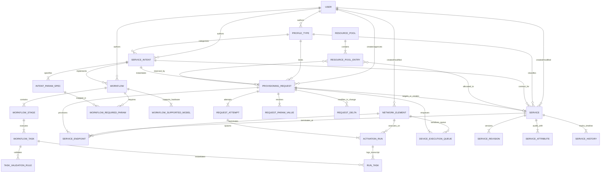

# Telecom LCM Orchestrator: Complete Database Design & Architecture Guide (English Edition)

This document provides a comprehensive architectural and design guide for the **Telecom Lifecycle Management (LCM) Orchestrator** database. It is fully synchronized with the React Frontend UI (`LCM-Orchestrator`), explaining all 24 schema tables, column dictionaries, dummy seed data examples, visual ER diagrams, decoupled microservices patterns, and data flow mappings.

---

## 1. Master Database Table Directory (25 Tables Overview)

Below is the complete directory of all 25 tables categorized by architectural module:

| # | Table Name | Architecture Module | Primary Key (PK) | Purpose & UI Screen Link |
| :---: | :--- | :--- | :--- | :--- |
| **1** | **`USER`** | User & Platform Sync | `ID` (`BIGINT UNSIGNED`) | Platform-synced engineers who author, approve, or execute provisioning workflows. |
| **2** | **`NETWORK_ELEMENT`** | Network Inventory | `ID` (`BIGINT UNSIGNED`) | Direct physical and virtual router hardware inventory (ASR9k, MX204, NCS540). |
| **3** | **`PROFILE_TYPE`** | Product Catalog | `ID` (`INT UNSIGNED`) | 3-tier product taxonomy hierarchy (Domain, Category, Type, Subtype) — Screen 5: Profile Types. |
| **4** | **`SERVICE_INTENT`** | Product Catalog | `ID` (`INT UNSIGNED`) | Service blueprint contract linked directly to `PROFILE_TYPE_ID_FK`. |
| **5** | **`INTENT_PARAM_SPEC`** | Product Catalog | `ID` (`INT UNSIGNED`) | Dynamic form schema for blueprint parameters (Min/Max ranges, pool sources) — Wizard Step 3. |
| **6** | **`WORKFLOW`** | Configuration Recipes | `ID` (`BIGINT UNSIGNED`) | Vendor CLI workflow templates (Taxonomy derived via `SERVICE_INTENT_ID_FK`). |
| **7** | **`WORKFLOW_SUPPORTED_MODEL`**| Configuration Recipes | `ID` (`INT UNSIGNED`) | Hardware chassis models compatible with the workflow (`ASR-9006`, `MX204`). |
| **8** | **`WORKFLOW_REQUIRED_PARAM`**| Configuration Recipes | `ID` (`INT UNSIGNED`) | Many-to-many junction: Parameters required by this workflow out of the 10 catalog specs. |
| **9** | **`WORKFLOW_STAGE`** | Configuration Recipes | `ID` (`INT UNSIGNED`) | 3 sequential execution pipeline stages (Pre Validation, Configuration, Post Validation). |
| **10** | **`WORKFLOW_TASK`** | Configuration Recipes | `ID` (`INT UNSIGNED`) | Atomic CLI commands with selective rollback, stop-rollback breaker, and retries. |
| **11** | **`TASK_VALIDATION_RULE`** | Configuration Recipes | `ID` (`INT UNSIGNED`) | Router output regex and literal assertions (Pass/Fail criteria). |
| **11** | **`RESOURCE_POOL`** | Resource Management | `ID` (`BIGINT UNSIGNED`) | Addressable capacity pools (VLAN, IP block, RD/RT, Pseudowire ID) — Screen 6: Resource Pools. |
| **12** | **`RESOURCE_POOL_ENTRY`** | Resource Management | `ID` (`INT UNSIGNED`) | Discrete allocatable units (VLAN 104, IP 10.244.12.0/30) with state (Free, Allocated, Quarantined). |
| **13** | **`SERVICE`** | Live Installed Base | `ID` (`VARCHAR(36)`) | Active customer circuits permanent asset registry — Screen 2: Service Inventory. |
| **14** | **`SERVICE_REVISION`** | Live Installed Base | `ID` (`VARCHAR(36)`) | Day-2 modification historical snapshots (100 Mbps -> 200 Mbps). |
| **15** | **`SERVICE_ENDPOINT`** | Live Installed Base | `ID` (`INT UNSIGNED`) | Termination endpoints directly binding router hardware (`NETWORK_ELEMENT`) and physical ports. |
| **16** | **`SERVICE_ATTRIBUTE`** | Conformance & Drift | `ID` (`INT UNSIGNED`) | Intent vs Realised comparison matrix detecting configuration drift and Ghost circuits. |
| **17** | **`SERVICE_HISTORY`** | Audit & Timeline | `ID` (`BIGINT UNSIGNED`) | Chronological timeline comparing portal changes against out-of-band CLI edits. |
| **18** | **`PROVISIONING_REQUEST`** | Execution Engine | `ID` (`VARCHAR(36)`) | In-flight provisioning orders, OMS external reference (`ORDER_ID`) — Screen 1 & Screen 3. |
| **19** | **`REQUEST_PARAM_VALUE`** | Execution Engine | `ID` (`INT UNSIGNED`) | Concrete runtime values dynamically substituted into CLI command `${Placeholders}`. |
| **20** | **`REQUEST_DELTA`** | Execution Engine | `ID` (`INT UNSIGNED`) | Day-2 attribute modification diffs (Current vs Requested) — Screen 3: Change & Cease. |
| **21** | **`DEVICE_EXECUTION_QUEUE`**| Execution Engine | `ID` (`BIGINT UNSIGNED`) | Per-Router Concurrency Lock queue preventing simultaneous SSH session lock collisions. |
| **22** | **`REQUEST_ATTEMPT`** | Execution Engine | `ID` (`VARCHAR(36)`) | Ticket execution attempts (Attempt 1, Retry Attempt 2) calculating First Time Right (FTR %). |
| **23** | **`ACTIVATION_RUN`** | Execution Engine | `ID` (`VARCHAR(36)`) | Individual SSH execution session per physical router (Bengaluru vs Mumbai). |
| **24** | **`RUN_TASK`** | Execution Engine | `ID` (`VARCHAR(36)`) | Router command execution transcript (CLI command, exit code, raw terminal output). |

---

## 2. Detailed Table & Column Dictionary (With Dummy / Seed Examples)

Below is the complete dictionary of all 24 tables. Every table's columns, data types, nullability, keys, default values, functional descriptions, and concrete dummy/seed examples matching the React UI mock dataset are organized in clean tabular format.

### 2.1. Table: `USER`
* **Architecture Module:** User & Platform Sync
* **Table Purpose & Why It Exists:** Corporate platforms maintain hundreds of network operators, NOC leads, and network architects. For regulatory compliance (SOX, ISO 27001) and security governance, every database record tracks who authored (`CREATOR`) and who last updated (`LAST_MODIFIER`) the entity.
* **What Is Stored in This Table:** Corporate SSO / Active Directory / Kafka CDC synced platform user identity (64-bit TSID, username, email, platform role: `ADMIN`, `NOC_LEAD`, `OPERATOR`, `ARCHITECT`, department, account active flag, and last login timestamp).
* **Real-World Telecom Example:** NOC Lead `Jayesh M.` (`523456789012345605`) from the `NOC Operations` team, who approved high-priority request `ORD-2026-004417` and authored the Cisco ASR9k workflow recipe.
* **UI Screen & Component Location:**
  - **Top Navigation Bar (`Header.tsx`):** Logged-in user profile, avatar, role badge (`NOC_LEAD`).
  - **Screen 1: Requests (`ProvisioningRequests.tsx`):** `Assigned / Owner` column (`Priya S.`), `Approved By` modal popup.
  - **Screen 4: Workflows (`Workflows.tsx`):** Workflow author pill tag.
  - **Screen 5: Catalog (`ProfileTypes.tsx`):** Creator column displaying engineer's name (`Jayesh M.`, `Raj V.`) via `CREATOR` foreign key.

| Column Name | Data Type | Nullable | Key | Default | Functional Description | Dummy / Seed Example Value |
| :--- | :--- | :---: | :---: | :--- | :--- | :--- |
| `ID` | `BIGINT UNSIGNED` | NO | PK | Auto | Unique 64-bit TSID engineer ID | `523456789012345601` |
| `CUSTOMER_ID` | `INT` | YES | | `NULL` | Multi-tenant customer / operator partition ID | `1` |
| `USERNAME` | `VARCHAR(64)` | NO | UK | — | Corporate login handle | `'ravi.k'` |
| `FULL_NAME` | `VARCHAR(128)` | NO | | — | Engineer full display name | `'Ravi K.'` |
| `EMAIL` | `VARCHAR(128)` | NO | UK | — | Corporate email address | `'ravi.k@telecom.net'` |
| `ROLE_CODE` | `ENUM` | NO | | `'OPERATOR'` | Platform role: `'ADMIN'`, `'NOC_LEAD'`, `'OPERATOR'`, `'ARCHITECT'` | `'NOC_LEAD'` |
| `DEPARTMENT` | `VARCHAR(64)` | NO | | `'NOC Operations'`| Team / Department | `'NOC Operations'` |
| `IS_ACTIVE` | `BOOLEAN` | NO | | `TRUE` | Account active flag (`TRUE`/`FALSE`) | `TRUE` |
| `LAST_LOGIN_TIME` | `DATETIME(6)` | YES | | `NULL` | Latest platform authentication timestamp | `'2026-09-24 10:00:00.000000'` |
| `CREATED_TIME` | `DATETIME(6)` | YES | | `NULL` | Record creation timestamp (microsecond precision) | `'2026-09-24 10:00:00.000000'` |
| `MODIFIED_TIME` | `DATETIME(6)` | YES | | `NULL` | Record last modification timestamp | `'2026-09-24 10:00:00.000000'` |
| `IS_DELETED` | `TINYINT(1)` | NO | | `0` | Universal soft-delete flag (`0` = Active, `1` = Deleted) | `0` |
| `CREATOR` | `BIGINT UNSIGNED` | YES | FK | `NULL` | User who created record (FK to `USER.ID`) | `523456789012345606` |
| `LAST_MODIFIER` | `BIGINT UNSIGNED` | YES | FK | `NULL` | User who last updated record (FK to `USER.ID`) | `523456789012345606` |

---

### 2.2. Table: `NETWORK_ELEMENT`
* **Architecture Module:** Network Inventory
* **Table Purpose & Why It Exists:** Authoritative physical and virtual network hardware inventory (Routers, Switches, OLTs, CPEs). Essential for the orchestrator to resolve target management IPs, CLI syntax variants, and active firmware OS versions.
* **What Is Stored in This Table:** 64-bit TSID router hardware ID, DNS hostname (`ASR9k-MUM-PE01`), telecom site code (`MH-MUM-0301`), city, region (`West`), vendor (`CISCO`, `JUNIPER`, `NOKIA`), chassis model (`ASR-9006`), device kind (`Router`), management IPv4/IPv6 address, OS firmware release (`IOS-XR 7.5.2`), admin state (`In Service`), operational telemetry state (`Up`/`Down`), and last network discovery scan timestamp.
* **Real-World Telecom Example:** Router `ASR9k-MUM-PE01` (Cisco ASR-9006, Site `MH-MUM-0301`, Mumbai, West Region, Mgmt IP `172.31.33.20`, IOS-XR 7.5.2) routing active enterprise customer traffic in the Mumbai metro core.
* **UI Screen & Component Location:**
  - **Screen 1: Create Request Wizard - Step 2 Endpoints (`NewRequestWizard.tsx`):** Source PE Router and Destination PE Router dropdown selection.
  - **Screen 2: Service Inventory (`ServiceInventory.tsx`):** Endpoints / Path column (`ASR9k-MUM-PE01:TenGigE0/0/0/1 ↔ MX204-BLR-PE02:ge-1/0/0`).
  - **Request Detail Drawer (`OrderDetail.tsx`):** Active target device banner, management IP connectivity pill, and clock skew telemetry monitor.

| Column Name | Data Type | Nullable | Key | Default | Functional Description | Dummy / Seed Example Value |
| :--- | :--- | :---: | :---: | :--- | :--- | :--- |
| `ID` | `BIGINT UNSIGNED` | NO | PK | — | 64-bit TSID router hardware ID | `600100200300400501` |
| `CUSTOMER_ID` | `INT` | YES | | `NULL` | Multi-tenant customer partition ID | `1` |
| `DEVICE_NAME` | `VARCHAR(128)` | NO | UK | — | Network hostname in DNS | `'ASR9k-MUM-PE01'` |
| `SITE_CODE` | `VARCHAR(32)` | NO | | — | Physical telecom site location | `'MH-MUM-0301'` |
| `CITY` | `VARCHAR(64)` | NO | | `'Mumbai'` | Metropolitan city | `'Mumbai'` |
| `REGION` | `ENUM` | NO | | `'West'` | Region: `'North'`, `'South'`, `'East'`, `'West'` | `'West'` |
| `VENDOR` | `VARCHAR(64)` | NO | | — | Hardware vendor / manufacturer: `'CISCO'`, `'JUNIPER'`, `'NOKIA'`, etc. | `'CISCO'` |
| `MODEL` | `VARCHAR(64)` | NO | | — | Chassis model name | `'ASR-9006'` |
| `DEVICE_KIND` | `ENUM` | NO | | `'Router'` | Classification: `'Router'`, `'Switch'`, `'CPE'`, `'OLT'` | `'Router'` |
| `MANAGEMENT_IP` | `VARCHAR(45)` | NO | | — | IP address used for SSH/Netconf execution | `'172.31.33.20'` |
| `OS_VERSION` | `VARCHAR(64)` | YES | | `NULL` | Active firmware release | `'IOS-XR 7.5.2'` |
| `ADMIN_STATE` | `ENUM` | NO | | `'In Service'` | Administrative state: `'In Service'`, `'Maintenance'`, `'Retired'` | `'In Service'` |
| `OPER_STATE` | `ENUM` | NO | | `'Up'` | Live polled operational telemetry state: `'Up'`, `'Down'` | `'Up'` |
| `LAST_DISCOVERED_TIME`| `DATETIME(6)`| YES | | `NULL` | Latest discovery scan timestamp | `'2026-09-24 09:30:00.000000'` |
| `CREATED_TIME` | `DATETIME(6)` | YES | | `NULL` | Record creation timestamp | `'2026-09-24 09:30:00.000000'` |
| `MODIFIED_TIME` | `DATETIME(6)` | YES | | `NULL` | Record update timestamp | `'2026-09-24 09:30:00.000000'` |
| `IS_DELETED` | `TINYINT(1)` | NO | | `0` | Soft-delete flag | `0` |
| `CREATOR` | `BIGINT UNSIGNED` | YES | FK | `NULL` | FK to `USER.ID` | `523456789012345601` |
| `LAST_MODIFIER` | `BIGINT UNSIGNED` | YES | FK | `NULL` | FK to `USER.ID` | `523456789012345601` |

---

### 2.3. Table: `PROFILE_TYPE`
* **Architecture Module:** Product Catalog
* **Table Purpose & Why It Exists:** 3-tier taxonomy classification engine. Enforces standardized product catalog taxonomy (Domain -> Category -> Type -> Subtype) across all workflows, provisioning requests, and active customer circuits.
* **What Is Stored in This Table:** Profile ID, telecom Domain (`Transport`, `Access`, `Radio`, `Fiber`), Product Category (`L3VPN`, `L2VPN`, `IBW`, `VLAN`), Topology Type (`Hub & Spoke`, `Point-to-point`), Subtype encapsulation (`VRF`, `Tagged`, `Untagged`), technical specification description, and authoring user foreign key (`CREATOR` referencing `USER.ID`).
* **Real-World Telecom Example:** Profile ID 1: Domain = `Transport`, Category = `L3VPN`, Type = `Hub & Spoke`, Subtype = `VRF`. Used to provision enterprise banking private MPLS WANs.
* **UI Screen & Component Location:**
  - **Screen 5: Profile Types (`ProfileTypes.tsx`):** Master catalog data grid with Domain pills, Category, Type, Subtype, Created Date, and Author (`Jayesh M.`).
  - **Screen 1: Create Request Wizard - Step 1 (`NewRequestWizard.tsx`):** Dynamic catalog taxonomy picker cards.

| Column Name | Data Type | Nullable | Key | Default | Functional Description | Dummy / Seed Example Value |
| :--- | :--- | :---: | :---: | :--- | :--- | :--- |
| `ID` | `INT UNSIGNED` | NO | PK | Auto | Taxonomy profile record ID | `1` |
| `CUSTOMER_ID` | `INT` | YES | | `NULL` | Multi-tenant customer partition ID | `1` |
| `DOMAIN` | `ENUM` | NO | | — | Domain: `'Transport'`, `'Access'`, `'Radio'`, `'Fiber'` | `'Transport'` |
| `CATEGORY` | `VARCHAR(32)` | NO | | — | Product category: `'L3VPN'`, `'L2VPN'`, `'IBW'`, `'VLAN'` | `'L3VPN'` |
| `TYPE` | `VARCHAR(64)` | NO | | — | Topology type: `'Hub & Spoke'`, `'Point-to-point'` | `'Hub & Spoke'` |
| `SUBTYPE` | `VARCHAR(64)` | NO | | — | Encapsulation flavor: `'VRF'`, `'Tagged'`, `'Untagged'` | `'VRF'` |
| `DESCRIPTION` | `TEXT` | YES | | `NULL` | Technical specification note | `'Enterprise Layer 3 private WAN'` |
| `CREATED_TIME` | `DATETIME(6)` | YES | | `NULL` | Record creation timestamp | `'2026-09-24 10:00:00.000000'` |
| `MODIFIED_TIME` | `DATETIME(6)` | YES | | `NULL` | Record update timestamp | `'2026-09-24 10:00:00.000000'` |
| `IS_DELETED` | `TINYINT(1)` | NO | | `0` | Soft-delete flag | `0` |
| `CREATOR` | `BIGINT UNSIGNED` | YES | FK | `NULL` | Author user ID (FK to `USER.ID`) | `523456789012345605` *(Jayesh M.)* |
| `LAST_MODIFIER` | `BIGINT UNSIGNED` | YES | FK | `NULL` | Modifier user ID (FK to `USER.ID`) | `523456789012345605` |

---

### 2.4. Table: `SERVICE_INTENT`
* **Architecture Module:** Product Catalog
* **Table Purpose & Why It Exists:** Master architectural service blueprint contract. Directly matches React UI (`ServiceIntents.tsx`):
  1. **Name-Based Version Forking & Lineage (`NAME` + `VERSION`):** No separate `FAMILY_ID` column is needed; lineage is tracked directly by intent `NAME` since all revisions share the exact same canonical product title (e.g., `'L3VPN Hub & Spoke'`). When an active intent is edited, the existing published row is immutable; the system forks a new `Draft` revision (`v2`, `v3`) preserving the identical `NAME` with incremented `VERSION`. The version history drawer (`v1 · Active`, `v2 · Draft`) is indexed and queried via `INDEX IDX_INTENT_NAME_VER (NAME, VERSION)`.
  2. **Clean Taxonomy Hierarchy (`PROFILE_TYPE_ID_FK`):** Redundant `CATEGORY` and `TYPE` text fields are deleted and replaced by a direct FK to `PROFILE_TYPE_ID_FK`, establishing a single source of truth for Domain, Category, Type, and Subtype.
  3. **Lifecycle State (`STATE`):** `Draft` (authoring mode, cannot be bound), `Active` (published & selectable in Workflow Builder), `Retired` (frozen, existing workflows unaffected). UI rule: only **Active** intents can be bound to new workflows.
  4. **Topology & Endpoint Cardinality:** Network topology (`Single-ended`, `Two-ended`, `Star`, `Full mesh`) and endpoint requirement (`exactly 1`, `exactly 2`, `1 hub + 1…n spokes`).
* **What Is Stored in This Table:** Intent blueprint code (`INT-L3-HUBSPOKE`), canonical product title (`NAME`), taxonomy FK (`PROFILE_TYPE_ID_FK`), topology shape, endpoint arity rules, version number (`VERSION`), lifecycle state (`Draft`/`Active`/`Retired`), live active circuits counter (`LIVE_SERVICES_COUNT = 96`), architectural contract description.
* **Real-World Telecom Example:** Blueprint `INT-L3-HUBSPOKE` (v1, Active) enforcing that circuits must consist of 1 Central Hub (Head Office DC) and 1 to N Spokes (branch offices). Currently 96 active enterprise circuits operate on this blueprint. Editing parameters forks a v2 Draft with the same name (`'L3VPN Hub & Spoke'`) and `VERSION = 2`.
* **UI Screen & Component Location:**
  - **Screen 5: Service Intents Catalog (`ServiceIntents.tsx`):** Intent blueprints table, lifecycle state badge (`Active · v1`), version history drawer, parameter manage modal, activate/retire kebab actions.
  - **Screen 4: Workflow Builder (`WorkflowBuilder.tsx`):** Service Intent dropdown selector (only `Active` intents are offered).
  - **Screen 1: Create Request Wizard - Step 1 (`NewRequestWizard.tsx`):** Master blueprint selection card dynamically generating downstream wizard steps.

| Column Name | Data Type | Nullable | Key | Default | Functional Description | Dummy / Seed Example Value |
| :--- | :--- | :---: | :---: | :--- | :--- | :--- |
| `ID` | `INT UNSIGNED` | NO | PK | Auto | Intent blueprint internal ID | `1` |
| `CUSTOMER_ID` | `INT` | YES | | `NULL` | Multi-tenant customer partition ID | `1` |
| `INTENT_CODE` | `VARCHAR(64)` | NO | UK | — | Public contract code (`INT-L3-HUBSPOKE`, `INT-L2-P2P`) | `'INT-L3-HUBSPOKE'` |
| `PROFILE_TYPE_ID_FK`| `INT UNSIGNED` | NO | FK | — | FK to master `PROFILE_TYPE(ID)` (Derives Domain, Category, Type, Subtype) | `1` |
| `NAME` | `VARCHAR(128)` | NO | MUL | — | Product blueprint title shared across all versions (`INDEX IDX_INTENT_NAME_VER`) | `'L3VPN Hub & Spoke'` |
| `TOPOLOGY` | `ENUM` | NO | | `'Two-ended'`| Topology: `'Single-ended'`, `'Two-ended'`, `'Star'`, `'Full mesh'` | `'Star'` |
| `ENDPOINT_ARITY` | `VARCHAR(64)` | NO | | `'exactly 2'`| Endpoints: `'1 hub + 1…n spokes'`, `'exactly 2'`, `'exactly 1'` | `'1 hub + 1…n spokes'` |
| `VERSION` | `INT UNSIGNED` | NO | MUL | `1` | Blueprint version revision number (`INDEX IDX_INTENT_NAME_VER`) | `1` |
| `STATE` | `ENUM` | NO | MUL | `'Draft'` | Intent lifecycle state: `'Draft'`, `'Active'`, `'Retired'` | `'Active'` |
| `LIVE_SERVICES_COUNT`| `INT UNSIGNED` | NO | | `0` | Count of active circuits currently using this blueprint | `96` |
| `DESCRIPTION` | `TEXT` | YES | | `NULL` | Architectural contract description | `'MPLS Layer 3 VPN topology'` |
| `CREATED_TIME` | `DATETIME(6)` | YES | | `NULL` | Record creation timestamp | `'2026-09-24 10:00:00.000000'` |
| `MODIFIED_TIME` | `DATETIME(6)` | YES | | `NULL` | Record update timestamp | `'2026-09-24 10:00:00.000000'` |
| `IS_DELETED` | `TINYINT(1)` | NO | | `0` | Universal soft-delete flag | `0` |
| `CREATOR` | `BIGINT UNSIGNED` | YES | FK | `NULL` | FK to `USER.ID` | `523456789012345605` |
| `LAST_MODIFIER` | `BIGINT UNSIGNED` | YES | FK | `NULL` | FK to `USER.ID` | `523456789012345605` |

---

### 2.5. Table: `INTENT_PARAM_SPEC`
* **Architecture Module:** Product Catalog
* **Table Purpose & Why It Exists:** Dynamic Form Builder Schema & Parameter Catalog. Drives the parameters displayed in the Service Intents Drawer and Request Wizard:
  1. **UI Sequence Ordering (`SEQUENCE`):** Stored to preserve the display ordering arranged by the Move Up / Move Down controls in the UI drawer.
  2. **Enum Options Support (`OPTIONS_CSV`):** For parameters with `PARAM_TYPE = 'enum'`, stores comma-separated options (e.g. `'tagged, transparent'`).
  3. **12 UI Auto-Allocation Resource Pools (`FROM_POOL_KIND`):** All 12 pools supported in UI: `'VLAN'`, `'RD/RT'`, `'Pseudowire ID'`, `'IP block'`, `'Sub-interface'`, `'ASN slot'`, `'CPE Serial'`, `'Frequency Channel'`, `'Wavelength'`, `'PCI'`, `'ONT Serial'`, `'PON Port'`.
  4. **Day-2 Modify Policy:** `hitless` (no packet loss), `bounce` (port flap), `recreate` (circuit teardown/rebuild), `no` (immutable).
* **What Is Stored in This Table:** Intent FK, sequence order, parameter placeholder name (`Bandwidth`, `vlan`, `vrf`), data type (`integer`, `string`, `ipv4`, `boolean`, `enum`), enum dropdown CSV, boundary limits (`min=10`, `max=10000`), validation regex / helper expression (`10-10000 Mbps`), Day-2 modification behavior, resource pool dispenser link (`FROM_POOL_KIND`), mandatory required flag (`TRUE`/`FALSE`), default pre-filled value.
* **Real-World Telecom Example:** Parameter `Bandwidth`: Sequence = `1`, Type = `integer`, Min = `10`, Max = `10000`, Modifiable = `hitless`, Default = `100`. Parameter `Encapsulation`: Sequence = `2`, Type = `enum`, Options = `'tagged, transparent'`, Modifiable = `bounce`. Parameter `Vlan-ID`: Sequence = `3`, Type = `integer`, Pool = `VLAN`, Modifiable = `recreate`.
* **UI Screen & Component Location:**
  - **Screen 5: Service Intents Drawer (`ServiceIntents.tsx`):** Parameter list table with Move Up/Down arrows, Type, Min, Max, Default, Required, Description, and Add/Edit Parameter modal.
  - **Screen 1: Create Request Wizard - Step 3: Parameters (`NewRequestWizard.tsx`):** Renders dynamic input form with number sliders, input boxes, enum dropdowns, pool auto-allocation toggles, and tooltip validation rules.
  - **Screen 4: Workflow Builder (`WorkflowBuilder.tsx`):** Placeholder chips list (`${Bandwidth}`, `${vlan}`) injected into CLI templates.

| Column Name | Data Type | Nullable | Key | Default | Functional Description | Dummy / Seed Example Value |
| :--- | :--- | :---: | :---: | :--- | :--- | :--- |
| `ID` | `INT UNSIGNED` | NO | PK | Auto | Parameter specification ID | `1` |
| `CUSTOMER_ID` | `INT` | YES | | `NULL` | Multi-tenant customer partition ID | `1` |
| `SERVICE_INTENT_ID_FK`| `INT UNSIGNED` | NO | FK | — | FK to parent `SERVICE_INTENT(ID)` | `1` |
| `SEQUENCE` | `INT UNSIGNED` | NO | MUL | `1` | Display and form ordering sequence (UI reorder up/down) | `1` |
| `PARAM_NAME` | `VARCHAR(64)` | NO | UK | — | CLI Placeholder name (`Bandwidth`, `vlan`, `vrf`) | `'Bandwidth'` |
| `PARAM_TYPE` | `ENUM` | NO | | — | Type: `'integer'`, `'string'`, `'boolean'`, `'ipv4'`, `'enum'` | `'integer'` |
| `OPTIONS_CSV` | `VARCHAR(512)`| YES | | `NULL` | Comma-separated options for enum type (e.g. tagged, transparent) | `NULL` |
| `MIN_VALUE` | `VARCHAR(64)` | YES | | `NULL` | Minimum acceptable boundary | `'10'` |
| `MAX_VALUE` | `VARCHAR(64)` | YES | | `NULL` | Maximum acceptable boundary | `'10000'` |
| `CONSTRAINT_EXPR`| `VARCHAR(255)`| YES | | `NULL` | Validation rule or helper tooltip | `'10-10000 Mbps'` |
| `MODIFIABLE` | `ENUM` | NO | | `'hitless'` | Day-2 modify behavior: `'hitless'`, `'bounce'`, `'recreate'`, `'no'` | `'hitless'` |
| `FROM_POOL_KIND`| `ENUM` | YES | | `NULL` | Auto-allocation pool (12 UI pools: `'VLAN'`, `'RD/RT'`, `'IP block'`, etc.) | `NULL` |
| `IS_REQUIRED` | `BOOLEAN` | NO | | `TRUE` | UI wizard mandatory field flag | `TRUE` |
| `DEFAULT_VALUE` | `VARCHAR(255)`| YES | | `NULL` | Pre-filled default value in UI form | `'100'` |
| `CREATED_TIME` | `DATETIME(6)` | YES | | `NULL` | Record creation timestamp | `'2026-09-24 10:00:00.000000'` |
| `MODIFIED_TIME` | `DATETIME(6)` | YES | | `NULL` | Record update timestamp | `'2026-09-24 10:00:00.000000'` |
| `IS_DELETED` | `TINYINT(1)` | NO | | `0` | Universal soft-delete flag | `0` |
| `CREATOR` | `BIGINT UNSIGNED` | YES | FK | `NULL` | FK to `USER.ID` | `523456789012345605` |
| `LAST_MODIFIER` | `BIGINT UNSIGNED` | YES | FK | `NULL` | FK to `USER.ID` | `523456789012345605` |

---

### 2.6. Table: `WORKFLOW`
* **Architecture Module:** Configuration Recipes
* **Table Purpose & Why It Exists:** Vendor-specific CLI configuration recipe template. Aligned with Workflow Builder canvas (`WorkflowBuilder.tsx`):
  1. **Single Source of Truth Taxonomy:** Category, Type, and Subtype are derived via `SERVICE_INTENT_ID_FK` from `PROFILE_TYPE`. Redundant columns (`CATEGORY`, `TYPE`, `PROFILE_TYPE_ID_FK`) are removed, ensuring strict 3NF compliance.
  2. **Flexible Hardware Vendors (`VENDOR VARCHAR(64)`):** Uses `VARCHAR(64)` instead of a rigid ENUM to allow dynamic vendor expansion without altering database tables or causing migration locks. Stores all 20 UI hardware vendors (`CISCO`, `JUNIPER`, `NOKIA`, `ADVA`, `TEJAS`, `TECHROUTE`, `EDGECORE`, `DLINK`, `HUAWEI`, `ZTE`, `ADTRAN`, `CERAGON`, `AVIAT`, `NEC`, `CIENA`, `INFINERA`, `ECI`, `MAVENIR`, `SAMSUNG`, `RADISYS`).
  3. **8 Device Kinds (`DEVICE_KIND`):** `Router`, `Switch`, `CPE`, `Radio`, `Optical`, `VNF`, `OLT`, `ONT`.
  4. **Supported OS Range (`OS_RANGE`):** Device OS compatibility (e.g. `'7.3 – 7.11'`, `'JunOS 21.4R – 23.4R'`).
  5. **Endpoint Role & State:** `ENDPOINT_ROLE` (`Source`, `Destination`, `Hub`, `Spoke`, `A`, `Z`), `STATE` (`Draft`, `Assigned`, `Awaiting approval`, `Active`, `Rejected`, `Retired`).
* **What Is Stored in This Table:** Recipe tracking code (`CF-000248`), intent contract FK (`SERVICE_INTENT_ID_FK`), composite workflow name, breadcrumb display name (`L3VPN Cisco ASR9k Hub`), vendor name (`CISCO`, `JUNIPER`, etc.), device kind (8 UI kinds), supported OS range (`OS_RANGE`), target role (`Source`, `Destination`), lifecycle state, template version, 30-day run count (`42`), first-pass yield rate (`95.20%`).
* **Real-World Telecom Example:** Workflow `CF-000248` (`L3VPN Cisco ASR9k Hub`), active production recipe for Cisco ASR9k routers (OS `7.3 – 7.11`) executed 42 times in the last 30 days with a 95.2% first-pass success rate.
* **UI Screen & Component Location:**
  - **Screen 4: Workflows (`Workflows.tsx`):** Recipe directory table with Vendor filter tabs, State badge (`Active`), 30-Day Runs column, and First-Pass Rate progress bar.
  - **Workflow Builder Canvas (`WorkflowBuilder.tsx`):** Pipeline header bar with Intent binding, Vendor, Models multi-select, Location (Source/Destination toggle), OS range, Auto-name generator, and Save/Submit for Approval controls.

| Column Name | Data Type | Nullable | Key | Default | Functional Description | Dummy / Seed Example Value |
| :--- | :--- | :---: | :---: | :--- | :--- | :--- |
| `ID` | `BIGINT UNSIGNED` | NO | PK | — | TSID workflow template ID | `700100200300400101` |
| `CUSTOMER_ID` | `INT` | YES | | `NULL` | Multi-tenant customer partition ID | `1` |
| `CODE` | `VARCHAR(32)` | NO | UK | — | Public tracking code | `'CF-000248'` |
| `SERVICE_INTENT_ID_FK`| `INT UNSIGNED` | NO | FK | — | FK to `SERVICE_INTENT` (Derives master `PROFILE_TYPE`) | `1` |
| `NAME` | `VARCHAR(128)` | NO | UK | — | Composite workflow title | `'L3VPN \| Hub & Spoke \| VRF \| Cisco \| Source 1'` |
| `DISPLAY_NAME` | `VARCHAR(128)` | NO | | — | Short title for navigation breadcrumbs | `'L3VPN Cisco ASR9k Hub'` |
| `VENDOR` | `VARCHAR(64)` | NO | | — | Target CLI hardware vendor (e.g. `'CISCO'`, `'JUNIPER'`, `'NOKIA'`, `'HUAWEI'`) | `'CISCO'` |
| `DEVICE_KIND` | `ENUM` | NO | | `'Router'` | Device kind (8 UI kinds: `'Router'`, `'Switch'`, `'CPE'`, `'Radio'`, `'Optical'`, `'VNF'`, `'OLT'`, `'ONT'`) | `'Router'` |
| `OS_RANGE` | `VARCHAR(128)`| YES | | `NULL` | Supported device OS range (e.g. 7.3 – 7.11, JunOS 21.4R – 23.4R) | `'7.3 – 7.11'` |
| `ENDPOINT_ROLE` | `ENUM` | YES | | `NULL` | Target endpoint role: `'Source'`, `'Destination'`, `'Hub'`, `'Spoke'`, `'A'`, `'Z'` | `'Source'` |
| `STATE` | `ENUM` | NO | MUL | `'Draft'` | Template status: `'Draft'`, `'Assigned'`, `'Awaiting approval'`, `'Active'`, `'Rejected'`, `'Retired'` | `'Active'` |
| `VERSION` | `INT UNSIGNED` | NO | | `1` | Template revision number | `1` |
| `RUNS_30D` | `INT UNSIGNED` | NO | | `0` | Number of executions in last 30 days | `42` |
| `FIRST_PASS_RATE`| `DECIMAL(5,2)` | NO | | `0.00` | First-pass yield percentage | `95.20` |
| `CREATED_TIME` | `DATETIME(6)` | YES | | `NULL` | Record creation timestamp | `'2026-09-24 10:00:00.000000'` |
| `MODIFIED_TIME` | `DATETIME(6)` | YES | | `NULL` | Record update timestamp | `'2026-09-24 10:00:00.000000'` |
| `IS_DELETED` | `TINYINT(1)` | NO | | `0` | Universal soft-delete flag | `0` |
| `CREATOR` | `BIGINT UNSIGNED` | YES | FK | `NULL` | FK to `USER.ID` | `523456789012345605` |
| `LAST_MODIFIER` | `BIGINT UNSIGNED` | YES | FK | `NULL` | FK to `USER.ID` | `523456789012345605` |

---

### 2.7. Table: `WORKFLOW_SUPPORTED_MODEL`
* **Architecture Module:** Configuration Recipes
* **Table Purpose & Why It Exists:** Hardware chassis compatibility guard. Cisco ASR9k modular chassis and Cisco NCS540 fixed chassis have different port naming and command structures; this table restricts workflows to compatible chassis models.
* **What Is Stored in This Table:** Parent workflow FK and compatible hardware chassis model names (`ASR-9006`, `ASR-9904`, `MX204`, `NCS-540`).
* **Real-World Telecom Example:** Workflow `700100200300400101` explicitly binds to chassis models `ASR-9006` and `ASR-9904`. Selecting an NCS-540 router prevents selection of this workflow.
* **UI Screen & Component Location:**
  - **Screen 4: Workflows Table (`Workflows.tsx`):** Models column rendering hardware tag pills (`ASR-9006`, `MX204`).
  - **Workflow Builder Canvas (`WorkflowBuilder.tsx`):** Model selector chip multi-select list.
  - **Screen 1: Create Request Wizard - Step 2 (`NewRequestWizard.tsx`):** Filters available workflows matching the selected PE router chassis model.

| Column Name | Data Type | Nullable | Key | Default | Functional Description | Dummy / Seed Example Value |
| :--- | :--- | :---: | :---: | :--- | :--- | :--- |
| `ID` | `INT UNSIGNED` | NO | PK | Auto | Primary key sequence | `1` |
| `CUSTOMER_ID` | `INT` | YES | | `NULL` | Multi-tenant customer partition ID | `1` |
| `WORKFLOW_ID_FK`| `BIGINT UNSIGNED` | NO | FK | — | FK to parent `WORKFLOW(ID)` | `700100200300400101` |
| `MODEL_NAME` | `VARCHAR(64)` | NO | | — | Supported hardware chassis name | `'ASR-9006'` |
| `CREATED_TIME` | `DATETIME(6)` | YES | | `NULL` | Record creation timestamp | `'2026-09-24 10:00:00.000000'` |
| `MODIFIED_TIME` | `DATETIME(6)` | YES | | `NULL` | Record update timestamp | `'2026-09-24 10:00:00.000000'` |
| `IS_DELETED` | `TINYINT(1)` | NO | | `0` | Universal soft-delete flag | `0` |
| `CREATOR` | `BIGINT UNSIGNED` | YES | FK | `NULL` | FK to `USER.ID` | `523456789012345605` |
| `LAST_MODIFIER` | `BIGINT UNSIGNED` | YES | FK | `NULL` | FK to `USER.ID` | `523456789012345605` |

---

### 2.8. Table: `WORKFLOW_REQUIRED_PARAM`
* **Architecture Module:** Configuration Recipes (Parameter Mapping)
* **Table Purpose & Why It Exists:** Many-to-Many junction mapping table between `WORKFLOW` and `INTENT_PARAM_SPEC`. If a `SERVICE_INTENT` defines 10 parameters, but a specific vendor CLI workflow (e.g. Cisco Hub PE) only uses 5 parameters in its CLI templates, this table records exactly which parameter specifications this workflow requires:
  - In Workflow Builder UI, parameters originate in two ways: (a) *Used automatically* (referenced as `${Parameter}` in task set commands), and (b) *Added manually / explicitParams* (explicitly added via the "+ Add parameter" dropdown).
  - This table persists the union of both!
* **What Is Stored in This Table:** `ID` (Surrogate PK), `WORKFLOW_ID_FK`, `INTENT_PARAM_SPEC_ID_FK`, and `IS_DELETED`.
* **Real-World Telecom Example:** Cisco ASR9k Hub Workflow (`700100200300400101`) requires `Bandwidth` (1), `VRF` (2), `Vlan-ID` (3), `Interface IP` (4), `RD` (5), and `RT` (6) from `INT-L3-HUBSPOKE`. This table stores these 6 mappings. Cisco NCS540 L2VPN (`700100200300400103`) only requires `Bandwidth` (7), `Vlan-ID` (8), and `pw_id` (9).
* **Which UI Screen Uses This Table:**
  - **Screen 4: Workflow Builder (`WorkflowBuilder.tsx`):** "Parameters in this workflow" card with "Used automatically" chips and "Added manually" dropdown.
  - **Screen 1: Provisioning Request Wizard Step 3 (`NewServiceWizard.tsx`):** When generating per-endpoint form cards, the system queries this table so that the Cisco PE card only asks for Cisco's parameters, and the Juniper PE card only asks for Juniper's parameters!

| Column Name | Data Type | Nullable | Key | Default | Functional Description | Dummy / Seed Example Value |
| :--- | :--- | :---: | :---: | :--- | :--- | :--- |
| `ID` | `INT UNSIGNED` | NO | PK | Auto | Internal surrogate primary key sequence | `1` |
| `WORKFLOW_ID_FK`| `BIGINT UNSIGNED` | NO | FK | — | FK to parent `WORKFLOW(ID)` (TSID) | `700100200300400101` |
| `INTENT_PARAM_SPEC_ID_FK`| `INT UNSIGNED` | NO | FK | — | FK to required `INTENT_PARAM_SPEC(ID)` | `1` |
| `IS_DELETED` | `TINYINT(1)` | NO | | `0` | Universal Soft-delete flag: 0=active, 1=deleted | `0` |

---

### 2.9. Table: `WORKFLOW_STAGE`
* **Architecture Module:** Configuration Recipes
* **Table Purpose & Why It Exists:** Pipeline execution stages order. Enforces that read-only pre-validation checks run before configuration push, followed by post-validation verification.
* **What Is Stored in This Table:** Parent workflow FK, stage technical name (`Pre Validation`), visual display name (`Pre Validation Checks`), stage kind (`Pre validation`, `Configuration`, `Post validation`), sequential execution order (1, 2, 3).
* **Real-World Telecom Example:** Stage 1 = `Pre Validation Checks` (Sequence 1, read-only port status check), Stage 2 = `Configuration Push` (Sequence 2, write VRF & Policer), Stage 3 = `Post Validation Verification` (Sequence 3, read BGP neighbor state).
* **UI Screen & Component Location:**
  - **Screen 4: Workflow Builder Canvas (`WorkflowBuilder.tsx`):** Horizontal stage columns across the visual drag-and-drop pipeline canvas.
  - **Request Detail - Lifecycle Tab (`OrderDetail.tsx`):** 3-step execution stepper showing current stage progress with animated spinners.

| Column Name | Data Type | Nullable | Key | Default | Functional Description | Dummy / Seed Example Value |
| :--- | :--- | :---: | :---: | :--- | :--- | :--- |
| `ID` | `INT UNSIGNED` | NO | PK | Auto | Stage ID | `1` |
| `CUSTOMER_ID` | `INT` | YES | | `NULL` | Multi-tenant customer partition ID | `1` |
| `WORKFLOW_ID_FK`| `BIGINT UNSIGNED` | NO | FK | — | FK to parent `WORKFLOW(ID)` | `700100200300400101` |
| `NAME` | `VARCHAR(64)` | NO | | — | Technical stage category name | `'Pre Validation'` |
| `DISPLAY_NAME` | `VARCHAR(64)` | NO | | — | Title rendered on visual pipeline canvas | `'Pre Validation Checks'` |
| `KIND` | `ENUM` | NO | | — | Stage: `'Pre validation'`, `'Configuration'`, `'Post validation'` | `'Pre validation'` |
| `SEQUENCE` | `INT UNSIGNED` | NO | | — | Sequential execution order: `1`, `2`, `3` | `1` |
| `CREATED_TIME` | `DATETIME(6)` | YES | | `NULL` | Record creation timestamp | `'2026-09-24 10:00:00.000000'` |
| `MODIFIED_TIME` | `DATETIME(6)` | YES | | `NULL` | Record update timestamp | `'2026-09-24 10:00:00.000000'` |
| `IS_DELETED` | `TINYINT(1)` | NO | | `0` | Soft-delete flag | `0` |
| `CREATOR` | `BIGINT UNSIGNED` | YES | FK | `NULL` | FK to `USER.ID` | `523456789012345605` |
| `LAST_MODIFIER` | `BIGINT UNSIGNED` | YES | FK | `NULL` | FK to `USER.ID` | `523456789012345605` |

---

### 2.9. Table: `WORKFLOW_TASK`
* **Architecture Module:** Configuration Recipes
* **Table Purpose & Why It Exists:** Atomic CLI command definition. Defines the forward CLI template, inverse rollback command, stop-rollback breaker, max retries, and execution timeouts for each command.
* **What Is Stored in This Table:** Task name, stage FK, sequence, kind (`read` vs `write`), CLI command template with placeholders (`interface ${Interface}.${Vlan-ID}`), inverse rollback command (`no interface ...`), stop-rollback breaker flag (`IS_ROLLBACK_STOP_POINT`), skip allowed flag, manual complete allowed flag, max retry count, retry interval, timeout in ms, affected attribute (`Bandwidth`).
* **Real-World Telecom Example:** Task `Set Policer & VRF`: Kind = `write`, Command = `interface ${Interface}.${Vlan-ID}\n vrf ${VRF_Name}\n service-policy input PM-${Bandwidth}M`, Rollback = `no interface ${Interface}.${Vlan-ID}`, Timeout = 90000 ms, Retries = 2, Breaker = `FALSE`.
* **UI Screen & Component Location:**
  - **Screen 4: Workflow Builder (`WorkflowBuilder.tsx`):** Task cards inside stage columns with CLI editor modal, rollback toggle, and retry configuration fields.
  - **Request Detail - Lifecycle Tab (`OrderDetail.tsx`):** Individual command execution rows with Skip / Retry / Manual Complete action buttons.

| Column Name | Data Type | Nullable | Key | Default | Functional Description | Dummy / Seed Example Value |
| :--- | :--- | :---: | :---: | :--- | :--- | :--- |
| `ID` | `INT UNSIGNED` | NO | PK | Auto | Task definition ID | `4` |
| `CUSTOMER_ID` | `INT` | YES | | `NULL` | Multi-tenant customer partition ID | `1` |
| `WORKFLOW_STAGE_ID_FK`| `INT UNSIGNED`| NO | FK | — | FK to parent `WORKFLOW_STAGE(ID)` | `2` |
| `NAME` | `VARCHAR(128)` | NO | | — | Technical task name | `'Set Policer & VRF'` |
| `DISPLAY_NAME` | `VARCHAR(128)` | NO | | — | Title displayed in task navigation tree | `'Apply Policer and Bind VRF to Port'` |
| `SEQUENCE` | `INT UNSIGNED` | NO | | — | Execution sequence within the stage | `2` |
| `KIND` | `ENUM` | NO | | `'read'` | Operation kind: `'read'` (show), `'write'` (config push) | `'write'` |
| `SET_COMMAND` | `TEXT` | NO | | — | CLI command with `${Placeholder}` substitutions | `'interface ${Interface}.${Vlan-ID}\n...'` |
| `IS_ROLLBACK_ENABLED`| `BOOLEAN` | NO | | `FALSE` | Triggers undo command if downstream fails | `TRUE` |
| `ROLLBACK_TEMPLATE`| `TEXT` | YES | | `NULL` | Inverse undo CLI command | `'no interface ${Interface}.${Vlan-ID}\n...'` |
| `IS_ROLLBACK_STOP_POINT`| `BOOLEAN`| NO | | `FALSE` | **Stop-Rollback Breaker:** Halts backwards rollback here | `FALSE` |
| `SKIP_ALLOWED` | `BOOLEAN` | NO | | `FALSE` | UI flag: Allows operator to skip this task | `FALSE` |
| `MANUAL_COMPLETE_ALLOWED`| `BOOLEAN`| NO | | `FALSE`| UI flag: Allows manual task completion | `FALSE` |
| `MAX_RETRY_COUNT`| `INT UNSIGNED`| NO | | `0` | Retry attempts before declaring failure | `2` |
| `RETRY_INTERVAL_SECONDS`| `INT UNSIGNED`| NO | | `5` | Wait duration in seconds between retries | `10` |
| `TIMEOUT_MS` | `INT UNSIGNED` | NO | | `60000` | SSH response timeout in milliseconds | `90000` |
| `DELAY_MS` | `INT UNSIGNED` | NO | | `0` | Delay in milliseconds before execution | `0` |
| `AFFECTS_ATTRIBUTE`| `VARCHAR(64)` | YES | | `NULL` | Parameter modified (used by Delta Diff engine) | `'Bandwidth'` |
| `CREATED_TIME` | `DATETIME(6)` | YES | | `NULL` | Record creation timestamp | `'2026-09-24 10:00:00.000000'` |
| `MODIFIED_TIME` | `DATETIME(6)` | YES | | `NULL` | Record update timestamp | `'2026-09-24 10:00:00.000000'` |
| `IS_DELETED` | `TINYINT(1)` | NO | | `0` | Soft-delete flag | `0` |
| `CREATOR` | `BIGINT UNSIGNED` | YES | FK | `NULL` | FK to `USER.ID` | `523456789012345605` |
| `LAST_MODIFIER` | `BIGINT UNSIGNED` | YES | FK | `NULL` | FK to `USER.ID` | `523456789012345605` |

---

### 2.10. Table: `TASK_VALIDATION_RULE`
* **Architecture Module:** Configuration Recipes
* **Table Purpose & Why It Exists:** Automated Pass/Fail assertion engine. Inspects the router CLI terminal response string to assert whether expected strings (e.g. `commit complete` or `BGP state = Established`) are present.
* **What Is Stored in This Table:** Task FK, sequence, boolean join type (`AND`, `OR`), match operator (`CONTAINS`, `REGEX_MATCH`, `EQUALS`, `NOT_CONTAINS`), expected string pattern, rollback assertion flag.
* **Real-World Telecom Example:** Rule 1 on `Commit Task`: Join = `AND`, Operator = `CONTAINS`, Expected Value = `'commit complete'`. Missing text triggers immediate failure and automated rollback.
* **UI Screen & Component Location:**
  - **Screen 4: Workflow Builder - Rule Drawer (`WorkflowBuilder.tsx`):** Assertion rule builder with regex validator tester and preview highlight.
  - **Request Detail Runs Drawer (`OrderDetail.tsx`):** Assertion status tag (e.g. `Assert: 'commit complete' -> PASSED`).

| Column Name | Data Type | Nullable | Key | Default | Functional Description | Dummy / Seed Example Value |
| :--- | :--- | :---: | :---: | :--- | :--- | :--- |
| `ID` | `INT UNSIGNED` | NO | PK | Auto | Validation rule ID | `5` |
| `CUSTOMER_ID` | `INT` | YES | | `NULL` | Multi-tenant customer partition ID | `1` |
| `WORKFLOW_TASK_ID_FK`| `INT UNSIGNED`| NO | FK | — | FK to target `WORKFLOW_TASK(ID)` | `4` |
| `SEQUENCE` | `INT UNSIGNED` | NO | | — | Rule evaluation sequence | `1` |
| `JOIN_TYPE` | `ENUM` | NO | | `'AND'` | Boolean combinator: `'AND'`, `'OR'` | `'AND'` |
| `OPERATOR` | `ENUM` | NO | | `'CONTAINS'`| Match operator: `'CONTAINS'`, `'REGEX_MATCH'`, etc. | `'CONTAINS'` |
| `EXPECTED_VALUE`| `VARCHAR(255)` | NO | | — | Match string or regex pattern | `'commit complete'` |
| `IS_ROLLBACK_RULE`| `BOOLEAN` | NO | | `FALSE` | Forward assertion vs Rollback assertion | `FALSE` |
| `CREATED_TIME` | `DATETIME(6)` | YES | | `NULL` | Record creation timestamp | `'2026-09-24 10:00:00.000000'` |
| `MODIFIED_TIME` | `DATETIME(6)` | YES | | `NULL` | Record update timestamp | `'2026-09-24 10:00:00.000000'` |
| `IS_DELETED` | `TINYINT(1)` | NO | | `0` | Soft-delete flag | `0` |
| `CREATOR` | `BIGINT UNSIGNED` | YES | FK | `NULL` | FK to `USER.ID` | `523456789012345605` |
| `LAST_MODIFIER` | `BIGINT UNSIGNED` | YES | FK | `NULL` | FK to `USER.ID` | `523456789012345605` |

---

### 2.11. Table: `RESOURCE_POOL`
* **Architecture Module:** Resource Pools (Capacity Containers)
* **Table Purpose & Why It Exists:** Capacity container management. Prevents resource collisions and provides automated assignment for shared network assets (VLAN IDs 1-4094, IP subnets `/30`, Route Distinguishers, MPLS Pseudowire IDs).
* **What Is Stored in This Table:** TSID pool ID, pool code (`POOL-VLAN-001`), kind (`VLAN`, `IP block`, `RD/RT`, `Pseudowire ID`), scope boundary (`Global Core Metro`), total capacity (`1000`), allocated count (`420`), quarantined count (`15`), reserved count (`5`).
* **Real-World Telecom Example:** `POOL-VLAN-001` (Kind = `VLAN`, Scope = `Global Core Metro`, Total = 1000, Allocated = 420, Quarantined = 15, Reserved = 5, Free = 560).
* **UI Screen & Component Location:**
  - **Screen 6: Resource Pools (`ResourcePools.tsx`):** Master resource cards with capacity progress bars (% utilized, % quarantined, % free), pool kind badges, and scope labels.
  - **Screen 1: Create Request Wizard - Step 3 (`NewRequestWizard.tsx`):** Auto-allocate pool selector dropdown.

| Column Name | Data Type | Nullable | Key | Default | Functional Description | Dummy / Seed Example Value |
| :--- | :--- | :---: | :---: | :--- | :--- | :--- |
| `ID` | `BIGINT UNSIGNED` | NO | PK | — | TSID capacity pool ID | `800100200300400101` |
| `CUSTOMER_ID` | `INT` | YES | | `NULL` | Multi-tenant customer partition ID | `1` |
| `CODE` | `VARCHAR(32)` | NO | UK | — | Public pool code | `'POOL-VLAN-001'` |
| `KIND` | `ENUM` | NO | | — | Pool asset type: `'VLAN'`, `'IP block'`, `'RD/RT'`, `'Pseudowire ID'` | `'VLAN'` |
| `SCOPE` | `VARCHAR(128)` | NO | | — | Applicability boundary: Global, or site-scoped | `'Global Core Metro'` |
| `TOTAL_CAPACITY`| `INT UNSIGNED` | NO | | — | Total capacity count | `1000` |
| `ALLOCATED_COUNT`| `INT UNSIGNED`| NO | | `0` | Number of values committed to live circuits | `420` |
| `QUARANTINED_COUNT`| `INT UNSIGNED`| NO | | `0` | Values held in quarantine cooldown | `15` |
| `RESERVED_COUNT`| `INT UNSIGNED` | NO | | `0` | Values locked by in-flight requests | `5` |
| `CREATED_TIME` | `DATETIME(6)` | YES | | `NULL` | Record creation timestamp | `'2026-09-24 10:00:00.000000'` |
| `MODIFIED_TIME` | `DATETIME(6)` | YES | | `NULL` | Record update timestamp | `'2026-09-24 10:00:00.000000'` |
| `IS_DELETED` | `TINYINT(1)` | NO | | `0` | Soft-delete flag | `0` |
| `CREATOR` | `BIGINT UNSIGNED` | YES | FK | `NULL` | FK to `USER.ID` | `523456789012345601` |
| `LAST_MODIFIER` | `BIGINT UNSIGNED` | YES | FK | `NULL` | FK to `USER.ID` | `523456789012345601` |

---

### 2.12. Table: `RESOURCE_POOL_ENTRY`
* **Architecture Module:** Resource Pools (Allocations)
* **Table Purpose & Why It Exists:** Discrete capacity unit ledger. Tracks the exact allocation lifecycle and mandatory 30-day quarantine for each addressable unit (e.g. VLAN `104`, IP `10.244.12.0/30`) to avoid stale routing loops.
* **What Is Stored in This Table:** Pool FK, concrete resource value string (`104`), state (`Free`, `Allocated`, `Quarantined`, `Reserved`), active service FK, reserving request FK, released timestamp, quarantine expiry timestamp (`QUARANTINE_UNTIL`).
* **Real-World Telecom Example:** Entry `VLAN 104`: State = `Allocated`, Service = `SVC-L2-018842` (Excitel). Upon circuit cease, transitions to `Quarantined` locked until `QUARANTINE_UNTIL = CURRENT_TIMESTAMP + 30 days`.
* **UI Screen & Component Location:**
  - **Screen 6: Resource Pools Drill-Down Drawer (`ResourcePools.tsx`):** Paginated entries table showing Value (`104`), State pill (`Allocated`), Linked Circuit link (`SVC-L2-018842`), and Quarantine Countdown timer.

| Column Name | Data Type | Nullable | Key | Default | Functional Description | Dummy / Seed Example Value |
| :--- | :--- | :---: | :---: | :--- | :--- | :--- |
| `ID` | `INT UNSIGNED` | NO | PK | Auto | Entry ID | `1` |
| `CUSTOMER_ID` | `INT` | YES | | `NULL` | Multi-tenant customer partition ID | `1` |
| `RESOURCE_POOL_ID_FK`| `BIGINT UNSIGNED`| NO | FK | — | FK to parent `RESOURCE_POOL(ID)` | `800100200300400101` |
| `RESOURCE_VALUE`| `VARCHAR(64)` | NO | | — | Concrete allocated value | `'104'` |
| `STATE` | `ENUM` | NO | | `'Free'` | State: `'Free'`, `'Allocated'`, `'Quarantined'`, `'Reserved'` | `'Allocated'` |
| `SERVICE_ID_FK` | `VARCHAR(36)` | YES | FK | `NULL` | Live circuit holding value (FK to `SERVICE.ID`) | `'SVC-L2-018842'` |
| `PROVISIONING_REQUEST_ID_FK`| `VARCHAR(36)`| YES | FK | `NULL`| In-flight request reserving value | `NULL` |
| `RELEASED_TIME` | `DATETIME(6)` | YES | | `NULL` | Timestamp when value was released | `NULL` |
| `QUARANTINE_UNTIL`| `DATETIME(6)` | YES | | `NULL` | Cooldown expiry timestamp | `NULL` |
| `CREATED_TIME` | `DATETIME(6)` | YES | | `NULL` | Record creation timestamp | `'2026-09-24 10:00:00.000000'` |
| `MODIFIED_TIME` | `DATETIME(6)` | YES | | `NULL` | Record update timestamp | `'2026-09-24 10:00:00.000000'` |
| `IS_DELETED` | `TINYINT(1)` | NO | | `0` | Soft-delete flag | `0` |
| `CREATOR` | `BIGINT UNSIGNED` | YES | FK | `NULL` | FK to `USER.ID` | `523456789012345601` |
| `LAST_MODIFIER` | `BIGINT UNSIGNED` | YES | FK | `NULL` | FK to `USER.ID` | `523456789012345601` |

---

### 2.13. Table: `SERVICE`
* **Architecture Module:** Live Installed Base (Screen 2: Service Inventory)
* **Table Purpose & Why It Exists:** Permanent active customer circuits registry. Once an in-flight request finishes, this table acts as the lifetime single source of truth tracking billing revenue, live telemetry health, and configuration drift.
* **What Is Stored in This Table:** UUID circuit ID (`SVC-L2-018842`), commercial service code (`NS-000114`), circuit customer name (`Excitel BLR ring — east leg`), customer account ID (`ACC-04417`), account name (`Excitel Business Solutions`), profile type FK, intent FK, service state (`Live`, `Activating`, `Suspended`, `Ceased`), operational state (`Up`, `Down`, `Degraded`), conformance verdict (`Conformant`, `Drifted`, `Ghost`), drift count (`1`), bandwidth Mbps (`100`), monthly revenue in INR (`₹1,20,000/mo`), live since timestamp, last proven audit timestamp.
* **Real-World Telecom Example:** `SVC-L2-018842`: Customer `Excitel Business Solutions`, 100 Mbps L2VPN, monthly billing ₹1,20,000/month, Live since 05-Aug-2024, Telemetry = `Up`, Conformance = `Drifted ×1`.
* **UI Screen & Component Location:**
  - **Screen 2: Service Inventory (`ServiceInventory.tsx`):** Master table with Service Code, Customer name, Speed badge (`100 Mbps`), Monthly Revenue pill (`₹1,20,000/mo`), Oper State dot (`Up`), Conformance badge (`Drifted ×1`), and Age column.
  - **Service Detail Page:** Circuit header banner with Cease / Modify action buttons.

| Column Name | Data Type | Nullable | Key | Default | Functional Description | Dummy / Seed Example Value |
| :--- | :--- | :---: | :---: | :--- | :--- | :--- |
| `ID` | `VARCHAR(36)` | NO | PK | — | UUID v7 circuit identifier in UI | `'SVC-L2-018842'` |
| `CUSTOMER_ID` | `INT` | YES | | `NULL` | Multi-tenant customer partition ID | `1` |
| `SERVICE_CODE` | `VARCHAR(32)` | NO | UK | — | Commercial service code | `'NS-000114'` |
| `NAME` | `VARCHAR(128)` | NO | | — | Circuit customer title | `'Excitel BLR ring — east leg'` |
| `ACCOUNT_ID` | `VARCHAR(64)` | NO | | `'ACC-04417'`| Customer billing account code | `'ACC-04417'` |
| `ACCOUNT_NAME` | `VARCHAR(128)` | NO | | — | Customer company name (Screen 2 Customer column) | `'Excitel Business Solutions'` |
| `PROFILE_TYPE_ID_FK`| `INT UNSIGNED` | YES | FK | `NULL` | FK to `PROFILE_TYPE` | `3` |
| `SERVICE_INTENT_ID_FK`| `INT UNSIGNED`| YES | FK | `NULL` | FK to `SERVICE_INTENT` | `2` |
| `SERVICE_STATE` | `ENUM` | NO | | `'Live'` | Contract lifecycle: `'Live'`, `'Activating'`, `'Suspended'`, `'Ceased'` | `'Live'` |
| `OPER_STATE` | `ENUM` | NO | | `'Up'` | Live polled telemetry: `'Up'`, `'Down'`, `'Degraded'` | `'Up'` |
| `CONFORMANCE` | `ENUM` | NO | | `'Conformant'`| Conformance verdict: `'Conformant'`, `'Drifted'`, `'Ghost'`, `'Not checked'` | `'Drifted'` |
| `DRIFT_COUNT` | `INT UNSIGNED` | NO | | `0` | Discrepancy count displayed as `×N` badge on Screen 2 | `1` |
| `BANDWIDTH_MBPS`| `INT UNSIGNED` | NO | | `100` | Committed bandwidth in Mbps | `100` |
| `MONTHLY_VALUE_INR`| `DECIMAL(12,2)`| NO | | `0.00` | Monthly revenue rendered as `₹XX,XXX/mo` | `120000.00` |
| `LIVE_SINCE` | `DATETIME(6)` | NO | | `NOW(6)` | Original activation timestamp (drives Age column) | `'2024-08-05 10:00:00.000000'` |
| `LAST_PROVEN_TIME`| `DATETIME(6)` | YES | | `NULL` | Latest audit pass timestamp (drives Last Proven column) | `'2026-09-24 06:00:00.000000'` |
| `CREATED_TIME` | `DATETIME(6)` | YES | | `NULL` | Record creation timestamp | `'2024-08-05 10:00:00.000000'` |
| `MODIFIED_TIME` | `DATETIME(6)` | YES | | `NULL` | Record update timestamp | `'2026-09-24 10:00:00.000000'` |
| `IS_DELETED` | `TINYINT(1)` | NO | | `0` | Soft-delete flag | `0` |
| `CREATOR` | `BIGINT UNSIGNED` | YES | FK | `NULL` | FK to `USER.ID` | `523456789012345602` |
| `LAST_MODIFIER` | `BIGINT UNSIGNED` | YES | FK | `NULL` | FK to `USER.ID` | `523456789012345602` |

---

### 2.14. Table: `SERVICE_REVISION`
* **Architecture Module:** Live Installed Base
* **Table Purpose & Why It Exists:** Version history snapshot ledger. Maintains an immutable chronological audit trail of all Day-2 modifications (bandwidth upgrade, port change, MTU change) applied to an active circuit.
* **What Is Stored in This Table:** Revision UUID (`REV-018f3a2c-0001`), parent service FK, revision number (1, 2, 3...), producing request FK, human-readable change summary text (`Initial provisioning creation at 100 Mbps`, `Upgraded bandwidth from 100 Mbps to 200 Mbps`).
* **Real-World Telecom Example:** Revision 1 created on 05-Aug-2024 for `SVC-L2-018842` at 100 Mbps. Revision 2 created on 24-Sep-2026 upgrading to 200 Mbps by request `ORD-2026-004417`.
* **UI Screen & Component Location:**
  - **Screen 2: Service Detail - History Tab (`ServiceDetail.tsx`):** Chronological revision timeline cards with diff summary and producing Order ID links.

| Column Name | Data Type | Nullable | Key | Default | Functional Description | Dummy / Seed Example Value |
| :--- | :--- | :---: | :---: | :--- | :--- | :--- |
| `ID` | `VARCHAR(36)` | NO | PK | — | Revision UUID | `'REV-018f3a2c-0001'` |
| `CUSTOMER_ID` | `INT` | YES | | `NULL` | Multi-tenant customer partition ID | `1` |
| `SERVICE_ID_FK` | `VARCHAR(36)` | NO | FK | — | FK to parent `SERVICE(ID)` | `'SVC-L2-018842'` |
| `REVISION_NUMBER`| `INT UNSIGNED` | NO | | — | Revision counter (`1` = create, `2` = modify) | `1` |
| `PROVISIONING_REQUEST_ID_FK`| `VARCHAR(36)`| YES | FK | `NULL`| FK to request that produced this revision | `'ORD-2026-004417'` |
| `CHANGE_SUMMARY`| `TEXT` | NO | | — | Human-readable diff summary | `'Initial provisioning creation at 100 Mbps'` |
| `CREATED_TIME` | `DATETIME(6)` | YES | | `NULL` | Record creation timestamp | `'2026-09-24 10:00:00.000000'` |
| `MODIFIED_TIME` | `DATETIME(6)` | YES | | `NULL` | Record update timestamp | `'2026-09-24 10:00:00.000000'` |
| `IS_DELETED` | `TINYINT(1)` | NO | | `0` | Soft-delete flag | `0` |
| `CREATOR` | `BIGINT UNSIGNED` | YES | FK | `NULL` | FK to `USER.ID` | `523456789012345602` |
| `LAST_MODIFIER` | `BIGINT UNSIGNED` | YES | FK | `NULL` | FK to `USER.ID` | `523456789012345602` |

---

### 2.15. Table: `SERVICE_ENDPOINT`
* **Architecture Module:** Live Installed Base / Request Fulfillment
* **Table Purpose & Why It Exists:** Direct physical network termination junction. Directly binds multi-point and point-to-point circuit endpoints to router hardware (`NETWORK_ELEMENT`) and physical ports (deriving Site, IP, Vendor, City).
* **What Is Stored in This Table:** Endpoint ID, service FK (for live circuit) OR request FK (for in-flight request), endpoint role (`A`, `Z`, `Source`, `Destination`, `Hub`, `Spoke`), router hardware FK (`NETWORK_ELEMENT`), physical port name (`TenGigE0/0/0/1`), logical sub-interface (`TenGigE0/0/0/1.104`), bound workflow FK.
* **Real-World Telecom Example:** A-end on Cisco NCS-540 router (`600100200300400503`) at port `TenGigE0/0/0/1.104`, Z-end on Juniper MX204 router (`600100200300400502`) at port `ge-1/0/0.104`.
* **UI Screen & Component Location:**
  - **Screen 1 & 3: Request Endpoints Matrix (`ProvisioningRequests.tsx`):** Endpoints column with bidirectional arrow (`DL-BLR ↔ MH-MUM`).
  - **Screen 2: Service Detail - Topology Tab (`ServiceDetail.tsx`):** Graphical endpoint termination cards showing Router Hostname, Site code, Port, and Sub-interface.

| Column Name | Data Type | Nullable | Key | Default | Functional Description | Dummy / Seed Example Value |
| :--- | :--- | :---: | :---: | :--- | :--- | :--- |
| `ID` | `INT UNSIGNED` | NO | PK | Auto | Endpoint ID | `1` |
| `CUSTOMER_ID` | `INT` | YES | | `NULL` | Multi-tenant customer partition ID | `1` |
| `SERVICE_ID_FK` | `VARCHAR(36)` | YES | FK | `NULL` | Live service link (NULL if request is in-flight) | `'SVC-L2-018842'` |
| `PROVISIONING_REQUEST_ID_FK`| `VARCHAR(36)`| YES | FK | `NULL`| In-flight request link (NULL if live) | `NULL` |
| `ROLE` | `ENUM` | NO | | — | Endpoint role: `'Source'`, `'Destination'`, `'A'`, `'Z'`, `'Hub'`, `'Spoke'` | `'A'` |
| `NETWORK_ELEMENT_ID_FK`| `BIGINT UNSIGNED`| NO | FK | — | Direct router hardware link | `600100200300400503` *(Cisco NCS-540)* |
| `PORT_NAME` | `VARCHAR(64)` | NO | | — | Physical router port | `'TenGigE0/0/0/1'` |
| `SUB_INTERFACE` | `VARCHAR(64)` | YES | | `NULL` | Logical sub-interface | `'TenGigE0/0/0/1.104'` |
| `WORKFLOW_ID_FK`| `BIGINT UNSIGNED`| YES | FK | `NULL` | Bound workflow recipe executing on this endpoint | `700100200300400103` |
| `CREATED_TIME` | `DATETIME(6)` | YES | | `NULL` | Record creation timestamp | `'2026-09-24 10:00:00.000000'` |
| `MODIFIED_TIME` | `DATETIME(6)` | YES | | `NULL` | Record update timestamp | `'2026-09-24 10:00:00.000000'` |
| `IS_DELETED` | `TINYINT(1)` | NO | | `0` | Soft-delete flag | `0` |
| `CREATOR` | `BIGINT UNSIGNED` | YES | FK | `NULL` | FK to `USER.ID` | `523456789012345602` |
| `LAST_MODIFIER` | `BIGINT UNSIGNED` | YES | FK | `NULL` | FK to `USER.ID` | `523456789012345602` |

---

### 2.16. Table: `SERVICE_ATTRIBUTE`
* **Architecture Module:** Conformance & Drift Detection
* **Table Purpose & Why It Exists:** Real-time drift detection & conformance audit matrix. Performs continuous side-by-side comparison between contracted DB intent and live physical router configuration to detect unauthorized manual changes.
* **What Is Stored in This Table:** Service FK, attribute name (`Bandwidth`, `VLAN`, `MTU`, `VRF`), contracted intent value in DB (`100 Mbps`), live polled value running on physical router (`200 Mbps`), source origin (`Order`, `Manual`), audit verdict (`Match`, `Drift`, `Absent`, `Not checked`), latest verified timestamp.
* **Real-World Telecom Example:** For `SVC-L2-018842`: Attribute `Bandwidth`: Intent = `'100 Mbps'`, Router = `'200 Mbps'`, Verdict = `'Drift'`. This triggers the orange `Drifted ×1` badge on Screen 2.
* **UI Screen & Component Location:**
  - **Screen 2: Service Inventory (`ServiceInventory.tsx`):** Conformance column rendering green `Conformant` badge or orange `Drifted ×N` badge.
  - **Service Detail - Realised Attributes Tab (`ServiceDetail.tsx`):** Side-by-side Intent vs Realised comparison table with drift highlight rows.

| Column Name | Data Type | Nullable | Key | Default | Functional Description | Dummy / Seed Example Value |
| :--- | :--- | :---: | :---: | :--- | :--- | :--- |
| `ID` | `INT UNSIGNED` | NO | PK | Auto | Attribute record ID | `2` |
| `CUSTOMER_ID` | `INT` | YES | | `NULL` | Multi-tenant customer partition ID | `1` |
| `SERVICE_ID_FK` | `VARCHAR(36)` | NO | FK | — | FK to parent `SERVICE(ID)` | `'SVC-L2-018842'` |
| `ATTRIBUTE_NAME`| `VARCHAR(64)` | NO | | — | Parameter name (`Bandwidth`, `VLAN`, `MTU`) | `'Bandwidth'` |
| `INTENT_VALUE` | `TEXT` | NO | | — | Contracted intent value in DB | `'100 Mbps'` |
| `ON_DEVICE_VALUE`| `TEXT` | YES | | `NULL` | Real value running on physical router | `'200 Mbps'` |
| `SOURCE_SYSTEM` | `ENUM` | NO | | `'Order'` | Origin: `'Order'`, `'Manual'`, `'Reserved'`, `'Derived'` | `'Manual'` |
| `VERDICT` | `ENUM` | NO | | `'Not checked'`| Audit outcome: `'Match'`, `'Drift'`, `'Absent'`, `'Not checked'` | `'Drift'` |
| `VERIFIED_TIME` | `DATETIME(6)` | YES | | `NULL` | Timestamp of latest comparison check | `'2026-09-24 06:00:00.000000'` |
| `CREATED_TIME` | `DATETIME(6)` | YES | | `NULL` | Record creation timestamp | `'2026-09-24 10:00:00.000000'` |
| `MODIFIED_TIME` | `DATETIME(6)` | YES | | `NULL` | Record update timestamp | `'2026-09-24 10:00:00.000000'` |
| `IS_DELETED` | `TINYINT(1)` | NO | | `0` | Soft-delete flag | `0` |
| `CREATOR` | `BIGINT UNSIGNED` | YES | FK | `NULL` | FK to `USER.ID` | `523456789012345601` |
| `LAST_MODIFIER` | `BIGINT UNSIGNED` | YES | FK | `NULL` | FK to `USER.ID` | `523456789012345601` |

---

### 2.17. Table: `SERVICE_HISTORY`
* **Architecture Module:** Audit & Timeline
* **Table Purpose & Why It Exists:** Out-of-band CLI change detection log. Distinguishes between changes executed cleanly via the portal versus manual configuration edits made directly on router terminals bypassing the portal.
* **What Is Stored in This Table:** Service FK, portal request FK (NULL if out-of-band), change description (`Bandwidth changed on device via CLI`), out-of-band boolean flag (`IS_OUT_OF_BAND = TRUE`), occurred timestamp.
* **Real-World Telecom Example:** On 09-Sep-2026, a NOC engineer applied `police rate 200 mbps` directly on the router CLI bypassing the portal. The orchestrator CDC scanner detected this and logged an out-of-band audit record.
* **UI Screen & Component Location:**
  - **Service Detail - Audit History Tab (`ServiceDetail.tsx`):** Timeline event feed displaying Out-of-band CLI badge (warning icon) vs Portal Provisioned badge.

| Column Name | Data Type | Nullable | Key | Default | Functional Description | Dummy / Seed Example Value |
| :--- | :--- | :---: | :---: | :--- | :--- | :--- |
| `ID` | `BIGINT UNSIGNED` | NO | PK | Auto | Append-only audit log ID | `1` |
| `CUSTOMER_ID` | `INT` | YES | | `NULL` | Multi-tenant customer partition ID | `1` |
| `SERVICE_ID_FK` | `VARCHAR(36)` | NO | FK | — | FK to parent `SERVICE(ID)` | `'SVC-L2-018842'` |
| `PROVISIONING_REQUEST_ID_FK`| `VARCHAR(36)`| YES | FK | `NULL`| FK to portal request; NULL if modified via direct CLI | `NULL` |
| `CHANGE_DESCRIPTION`| `TEXT` | NO | | — | Change action description | `'Bandwidth changed on device via CLI'` |
| `IS_OUT_OF_BAND`| `BOOLEAN` | NO | | `FALSE` | TRUE if made via direct router CLI bypassing portal | `TRUE` |
| `OCCURRED_TIME` | `DATETIME(6)` | NO | | `NOW(6)` | Timestamp when change occurred | `'2026-09-09 14:22:00.000000'` |
| `CREATED_TIME` | `DATETIME(6)` | YES | | `NULL` | Record creation timestamp | `'2026-09-24 10:00:00.000000'` |
| `MODIFIED_TIME` | `DATETIME(6)` | YES | | `NULL` | Record update timestamp | `'2026-09-24 10:00:00.000000'` |
| `IS_DELETED` | `TINYINT(1)` | NO | | `0` | Soft-delete flag | `0` |
| `CREATOR` | `BIGINT UNSIGNED` | YES | FK | `NULL` | FK to `USER.ID` | `523456789012345601` |
| `LAST_MODIFIER` | `BIGINT UNSIGNED` | YES | FK | `NULL` | FK to `USER.ID` | `523456789012345601` |

---

### 2.18. Table: `PROVISIONING_REQUEST`
* **Architecture Module:** Provisioning & Changes (Screen 1: Requests & Screen 3: Change & Cease)
* **Table Purpose & Why It Exists:** Central in-flight execution engine ticket. Decoupled from external OMS but linked via `ORDER_ID`; manages fast UI rendering cache columns and inline NOC Lead approvals.
* **What Is Stored in This Table:** UUID request ID (`ORD-2026-004417`), tracking code (`NS-000114`), external OMS Order ID (`OMS-ORD-04417`), commercial service code, circuit label, customer account ID & name, profile type FK, intent FK, intent action (`Create`, `Modify`, `Suspend`, `Cease`), target live service FK, request state (`Draft`, `Planned`, `Validated`, `In progress`, `Ready`, `Failed`), bound workflow FK, assigned engineer owner, waiting-on stakeholder, SLA breach flag, notes, inline approval status (`PENDING`, `APPROVED`, `REJECTED`), approver user FK (`USER.ID`), approval timestamp, comments.
* **Real-World Telecom Example:** `ORD-2026-004417`: Modify request for customer `Excitel Business Solutions` upgrading circuit `SVC-L2-018842` from 100M to 200M. Approved by NOC Lead `Ravi K.` (`523456789012345601`), Status = `In progress`, SLA = `Healthy`.
* **UI Screen & Component Location:**
  - **Screen 1: Requests (`ProvisioningRequests.tsx`):** Primary data grid with State tabs, Customer name, SLA status, Assigned owner, and Approval status badge.
  - **Screen 3: Change & Cease (`ChangeCease.tsx`):** In-flight change requests table.
  - **Approval Action Modal:** Populated when NOC Lead clicks Approve / Reject in the kebab menu.

| Column Name | Data Type | Nullable | Key | Default | Functional Description | Dummy / Seed Example Value |
| :--- | :--- | :---: | :---: | :--- | :--- | :--- |
| `ID` | `VARCHAR(36)` | NO | PK | — | UUID v7 public request identifier | `'ORD-2026-004417'` |
| `CUSTOMER_ID` | `INT` | YES | | `NULL` | Multi-tenant customer partition ID | `1` |
| `REQUEST_CODE` | `VARCHAR(32)` | NO | UK | — | Tracking code shown in UI subtitle | `'NS-000114'` |
| `ORDER_ID` | `VARCHAR(64)` | YES | | `NULL` | **External OMS Order ID accessed via Feign client** | `'OMS-ORD-04417'` |
| `SERVICE_CODE` | `VARCHAR(32)` | NO | | — | Commercial service code | `'NS-000114'` |
| `SERVICE_NAME` | `VARCHAR(128)` | NO | | — | Circuit title label | `'L2VPN Transparent'` |
| `ACCOUNT_ID` | `VARCHAR(64)` | NO | | `'ACC-04417'`| Customer billing account code | `'ACC-04417'` |
| `ACCOUNT_NAME` | `VARCHAR(128)` | NO | | — | Customer company name (Screen 1 Customer column) | `'Excitel Business Solutions'` |
| `PROFILE_TYPE_ID_FK`| `INT UNSIGNED` | YES | FK | `NULL` | FK to `PROFILE_TYPE` | `5` |
| `SERVICE_INTENT_ID_FK`| `INT UNSIGNED`| YES | FK | `NULL` | FK to `SERVICE_INTENT` | `2` |
| `INTENT` | `ENUM` | NO | | `'Create'` | Action: `'Create'`, `'Modify'`, `'Suspend'`, `'Cease'` | `'Modify'` |
| `TARGET_SERVICE_ID_FK`| `VARCHAR(36)` | YES | FK | `NULL` | FK to `SERVICE(ID)` if Day-2 modify/cease | `'SVC-L2-018842'` |
| `REQUEST_STATE` | `ENUM` | NO | | `'Draft'` | Status: `'Draft'`, `'Planned'`, `'Validated'`, `'In progress'`, `'Ready'`, `'Failed'` | `'In progress'` |
| `WORKFLOW_ID_FK`| `BIGINT UNSIGNED`| YES | FK | `NULL` | FK to bound `WORKFLOW(ID)` | `700100200300400103` |
| `OWNER` | `VARCHAR(64)` | YES | | `NULL` | Engineer owner (Assigned column) | `'Priya S.'` |
| `WAITING_ON` | `VARCHAR(64)` | YES | | `NULL` | Stakeholder holding action (Waiting On column) | `'Worker Execution'` |
| `SLA_BREACHED` | `BOOLEAN` | NO | | `FALSE` | Delivery SLA breach status flag | `FALSE` |
| `NOTES` | `TEXT` | YES | | `NULL` | Operator notes / justification | `'Bandwidth upgrade'` |
| `IS_ARCHIVED` | `BOOLEAN` | NO | | `FALSE` | History archive flag | `FALSE` |
| `APPROVAL_STATUS`| `ENUM` | NO | | `'NOT_REQUIRED'`| Inline approval: `'PENDING'`, `'APPROVED'`, `'REJECTED'` | `'APPROVED'` |
| `APPROVED_BY_USER_ID_FK`| `BIGINT UNSIGNED`| YES | FK | `NULL`| NOC Lead approver (FK to `USER.ID`) | `523456789012345601` |
| `APPROVED_TIME` | `DATETIME(6)` | YES | | `NULL` | Timestamp of approval decision | `'2026-09-24 09:00:00.000000'` |
| `APPROVAL_COMMENTS`| `TEXT` | YES | | `NULL` | Approval justification | `'Approved for daytime window'` |
| `CREATED_TIME` | `DATETIME(6)` | YES | | `NULL` | Request creation timestamp | `'2026-09-22 10:00:00.000000'` |
| `MODIFIED_TIME` | `DATETIME(6)` | YES | | `NULL` | Request update timestamp | `'2026-09-24 10:00:00.000000'` |
| `IS_DELETED` | `TINYINT(1)` | NO | | `0` | Soft-delete flag | `0` |
| `CREATOR` | `BIGINT UNSIGNED` | YES | FK | `NULL` | Creator user ID (FK to `USER.ID`) | `523456789012345602` |
| `LAST_MODIFIER` | `BIGINT UNSIGNED` | YES | FK | `NULL` | Modifier user ID (FK to `USER.ID`) | `523456789012345602` |

---

### 2.19. Table: `REQUEST_PARAM_VALUE`
* **Architecture Module:** Provisioning Execution
* **Table Purpose & Why It Exists:** Runtime resolved parameter storage. Stores concrete values entered by the user or allocated from resource pools to dynamically replace CLI command placeholders (`${Placeholder}`).
* **What Is Stored in This Table:** Request FK, optional endpoint FK, placeholder param name (`bandwidth_mbps`, `vlan`, `vrf`), concrete resolved string value (`200`, `104`, `VRF-BLR-104`), value source origin (`user`, `pool`, `derived`, `template`).
* **Real-World Telecom Example:** Param `bandwidth_mbps` = `'200'` (Source: `user`), Param `vlan` = `'104'` (Source: `pool`), Param `interface` = `'TenGigE0/0/0/1'` (Source: `derived`).
* **UI Screen & Component Location:**
  - **Screen 1: Request Detail - Parameters Tab (`OrderDetail.tsx`):** Resolved parameter summary grid with Source badges (`User`, `Pool Auto-allocated`, `Derived`).
  - **Screen 1: Create Request Wizard - Step 3 Review (`NewRequestWizard.tsx`):** Pre-execution parameter validation table.

| Column Name | Data Type | Nullable | Key | Default | Functional Description | Dummy / Seed Example Value |
| :--- | :--- | :---: | :---: | :--- | :--- | :--- |
| `ID` | `INT UNSIGNED` | NO | PK | Auto | Parameter record ID | `4` |
| `CUSTOMER_ID` | `INT` | YES | | `NULL` | Multi-tenant customer partition ID | `1` |
| `PROVISIONING_REQUEST_ID_FK`| `VARCHAR(36)`| NO | FK | — | FK to parent `PROVISIONING_REQUEST(ID)` | `'ORD-2026-004417'` |
| `SERVICE_ENDPOINT_ID_FK`| `INT UNSIGNED`| YES | FK | `NULL`| Endpoint binding (NULL if global) | `5` |
| `PARAM_NAME` | `VARCHAR(64)` | NO | | — | Template placeholder name | `'bandwidth_mbps'` |
| `PARAM_VALUE` | `TEXT` | NO | | — | Concrete resolved value | `'200'` |
| `SOURCE` | `ENUM` | NO | | `'user'` | Origin: `'user'`, `'pool'`, `'derived'`, `'template'` | `'user'` |
| `CREATED_TIME` | `DATETIME(6)` | YES | | `NULL` | Record creation timestamp | `'2026-09-24 10:00:00.000000'` |
| `MODIFIED_TIME` | `DATETIME(6)` | YES | | `NULL` | Record update timestamp | `'2026-09-24 10:00:00.000000'` |
| `IS_DELETED` | `TINYINT(1)` | NO | | `0` | Soft-delete flag | `0` |
| `CREATOR` | `BIGINT UNSIGNED` | YES | FK | `NULL` | FK to `USER.ID` | `523456789012345602` |
| `LAST_MODIFIER` | `BIGINT UNSIGNED` | YES | FK | `NULL` | FK to `USER.ID` | `523456789012345602` |

---

### 2.20. Table: `REQUEST_DELTA`
* **Architecture Module:** Change & Cease (Screen 3: Change & Cease)
* **Table Purpose & Why It Exists:** Day-2 modification diff engine. Calculates attribute-level differences between current live circuit configurations and requested target states, assessing traffic impact.
* **What Is Stored in This Table:** Request FK, attribute name (`Bandwidth`), current value on router (`100 Mbps`), new requested target value (`200 Mbps`), traffic impact classification (`Hitless` vs `Interrupts service`).
* **Real-World Telecom Example:** Attribute `Bandwidth`: Current = `'100 Mbps'`, Requested = `'200 Mbps'`, Traffic Impact = `'Hitless'` (Green badge because policer swap causes zero packet loss).
* **UI Screen & Component Location:**
  - **Screen 3: Change & Cease (`ChangeCease.tsx`):** Modification comparison table with Current vs Requested diff columns and Traffic Impact pill (`Hitless` / `Interrupts service`).

| Column Name | Data Type | Nullable | Key | Default | Functional Description | Dummy / Seed Example Value |
| :--- | :--- | :---: | :---: | :--- | :--- | :--- |
| `ID` | `INT UNSIGNED` | NO | PK | Auto | Delta record ID | `1` |
| `CUSTOMER_ID` | `INT` | YES | | `NULL` | Multi-tenant customer partition ID | `1` |
| `PROVISIONING_REQUEST_ID_FK`| `VARCHAR(36)`| NO | FK | — | FK to parent `PROVISIONING_REQUEST(ID)` | `'ORD-2026-004417'` |
| `ATTRIBUTE_NAME`| `VARCHAR(64)` | NO | | — | Parameter undergoing change | `'Bandwidth'` |
| `CURRENT_VALUE` | `VARCHAR(255)`| NO | | — | Value currently running on router | `'100 Mbps'` |
| `REQUESTED_VALUE`| `VARCHAR(255)`| NO | | — | New requested target value | `'200 Mbps'` |
| `TRAFFIC_IMPACT`| `ENUM` | NO | | `'Hitless'` | UI badge: `'Hitless'`, `'Interrupts service'` | `'Hitless'` |
| `CREATED_TIME` | `DATETIME(6)` | YES | | `NULL` | Record creation timestamp | `'2026-09-24 10:00:00.000000'` |
| `MODIFIED_TIME` | `DATETIME(6)` | YES | | `NULL` | Record update timestamp | `'2026-09-24 10:00:00.000000'` |
| `IS_DELETED` | `TINYINT(1)` | NO | | `0` | Soft-delete flag | `0` |
| `CREATOR` | `BIGINT UNSIGNED` | YES | FK | `NULL` | FK to `USER.ID` | `523456789012345602` |
| `LAST_MODIFIER` | `BIGINT UNSIGNED` | YES | FK | `NULL` | FK to `USER.ID` | `523456789012345602` |

---

### 2.21. Table: `DEVICE_EXECUTION_QUEUE`
* **Architecture Module:** Provisioning Concurrency Control
* **Table Purpose & Why It Exists:** Per-Router Serialized Concurrency Lock. Prevents configuration corruption and terminal crashes by strictly serializing execution requests targeting the same router hardware in FIFO order.
* **What Is Stored in This Table:** Queue ID, target router hardware FK (`NETWORK_ELEMENT`), waiting request FK (`PROVISIONING_REQUEST`), queue status (`QUEUED`, `PROCESSING`, `COMPLETED`, `FAILED`), priority (1-10), scheduled execution window time, locking worker thread ID, lock acquired timestamp, lock released timestamp.
* **Real-World Telecom Example:** Queue entry on router `NCS540-BLR-PE01`: Request `ORD-2026-004417` is `PROCESSING`, locked by worker thread `worker-thread-01` since 10:00 AM. Subsequent requests wait in `QUEUED` state until lock release.
* **UI Screen & Component Location:**
  - **Request Detail Drawer (`OrderDetail.tsx`):** Queue status pill (`Device Lock: Processing (Thread-01)`), Scheduled Window countdown banner.

| Column Name | Data Type | Nullable | Key | Default | Functional Description | Dummy / Seed Example Value |
| :--- | :--- | :---: | :---: | :--- | :--- | :--- |
| `ID` | `BIGINT UNSIGNED` | NO | PK | Auto | Queue dispatch sequence | `1` |
| `CUSTOMER_ID` | `INT` | YES | | `NULL` | Multi-tenant customer partition ID | `1` |
| `NETWORK_ELEMENT_ID_FK`| `BIGINT UNSIGNED`| NO | FK | — | Target router hardware lock key | `600100200300400503` *(NCS540)* |
| `PROVISIONING_REQUEST_ID_FK`| `VARCHAR(36)`| NO | FK | — | Request awaiting execution on device | `'ORD-2026-004417'` |
| `QUEUE_STATUS` | `ENUM` | NO | | `'QUEUED'` | Queue status: `'QUEUED'`, `'PROCESSING'`, `'COMPLETED'`, `'FAILED'` | `'PROCESSING'` |
| `PRIORITY` | `INT UNSIGNED` | NO | | `5` | Execution priority: 1 (Urgent) to 10 (Low) | `5` |
| `SCHEDULED_TIME`| `DATETIME(6)` | NO | | `NOW(6)` | Maintenance window scheduled execution time | `'2026-09-24 10:00:00.000000'` |
| `LOCKED_BY_WORKER`| `VARCHAR(64)`| YES | | `NULL` | Worker thread holding device lock | `'worker-thread-01'` |
| `LOCKED_TIME` | `DATETIME(6)` | YES | | `NULL` | Lock acquisition timestamp | `'2026-09-24 10:00:00.000000'` |
| `RELEASED_TIME` | `DATETIME(6)` | YES | | `NULL` | Lock release timestamp | `NULL` |
| `CREATED_TIME` | `DATETIME(6)` | YES | | `NULL` | Record creation timestamp | `'2026-09-24 10:00:00.000000'` |
| `MODIFIED_TIME` | `DATETIME(6)` | YES | | `NULL` | Record update timestamp | `'2026-09-24 10:00:00.000000'` |
| `IS_DELETED` | `TINYINT(1)` | NO | | `0` | Soft-delete flag | `0` |
| `CREATOR` | `BIGINT UNSIGNED` | YES | FK | `NULL` | FK to `USER.ID` | `523456789012345601` |
| `LAST_MODIFIER` | `BIGINT UNSIGNED` | YES | FK | `NULL` | FK to `USER.ID` | `523456789012345601` |

---

### 2.22. Table: `REQUEST_ATTEMPT`
* **Architecture Module:** Execution Hierarchy (Attempt Tracker)
* **Table Purpose & Why It Exists:** Execution attempt lifecycle tracker. Records how many times a ticket was executed (`ATTEMPT_NUMBER = 1, 2, ...`) to calculate the platform's First Time Right (FTR %) efficiency metric.
* **What Is Stored in This Table:** Attempt UUID (`ATT-018f3a2c-0001`), request FK, attempt counter (`1` = initial try, `2` = retry after fixing fiber), execution outcome (`Running`, `Accepted`, `Failed`, `Rolled back`), started timestamp, ended timestamp.
* **Real-World Telecom Example:** `ATT-018f3a2c-0001`: Attempt 1 on `ORD-2026-004417`, Outcome = `Running`, Started = 09:48:00 AM. If an attempt fails, operator clicks 'Retry' in the UI creating Attempt 2.
* **UI Screen & Component Location:**
  - **Screen 1: Request Detail - Execution Runs Tab (`OrderDetail.tsx`):** Attempt switcher dropdown (`Attempt #1 (Failed) | Attempt #2 (Running)`), Retry Execution action button.
  - **Dashboard Overview:** First-Time-Right (FTR %) efficiency KPI gauge.

| Column Name | Data Type | Nullable | Key | Default | Functional Description | Dummy / Seed Example Value |
| :--- | :--- | :---: | :---: | :--- | :--- | :--- |
| `ID` | `VARCHAR(36)` | NO | PK | — | Attempt record ID | `'ATT-018f3a2c-0001'` |
| `CUSTOMER_ID` | `INT` | YES | | `NULL` | Multi-tenant customer partition ID | `1` |
| `PROVISIONING_REQUEST_ID_FK`| `VARCHAR(36)`| NO | FK | — | FK to parent `PROVISIONING_REQUEST(ID)` | `'ORD-2026-004417'` |
| `ATTEMPT_NUMBER`| `INT UNSIGNED` | NO | | — | Attempt counter: `1` (first try), `2` (retry) | `1` |
| `OUTCOME` | `ENUM` | NO | | `'Running'` | Verdict: `'Running'`, `'Accepted'`, `'Failed'`, `'Rolled back'` | `'Running'` |
| `STARTED_TIME` | `DATETIME(6)` | NO | | `NOW(6)` | Start timestamp of attempt | `'2026-09-24 09:48:00.000000'` |
| `ENDED_TIME` | `DATETIME(6)` | YES | | `NULL` | Completion timestamp of attempt | `NULL` |
| `CREATED_TIME` | `DATETIME(6)` | YES | | `NULL` | Record creation timestamp | `'2026-09-24 09:48:00.000000'` |
| `MODIFIED_TIME` | `DATETIME(6)` | YES | | `NULL` | Record update timestamp | `'2026-09-24 09:48:00.000000'` |
| `IS_DELETED` | `TINYINT(1)` | NO | | `0` | Soft-delete flag | `0` |
| `CREATOR` | `BIGINT UNSIGNED` | YES | FK | `NULL` | FK to `USER.ID` | `523456789012345602` |
| `LAST_MODIFIER` | `BIGINT UNSIGNED` | YES | FK | `NULL` | FK to `USER.ID` | `523456789012345602` |

---

### 2.23. Table: `ACTIVATION_RUN`
* **Architecture Module:** Execution Hierarchy (Per-Router SSH Session)
* **Table Purpose & Why It Exists:** Per-Router SSH connection session. Telecom circuits span multiple devices (A-end Cisco in Bengaluru, Z-end Juniper in Mumbai); an activation run encapsulates the discrete SSH connection to one physical router and logs clock skew.
* **What Is Stored in This Table:** Run UUID (`RUN-000001`), attempt FK, request FK, endpoint FK, target router hardware FK (`NETWORK_ELEMENT`), workflow FK, execution direction (`forward` config push vs `rollback` undo), outcome (`Running`, `Accepted`, `Failed`), started/ended timestamps, duration in ms, router device clock time, clock skew difference in ms.
* **Real-World Telecom Example:** `RUN-000001` on router `Cisco NCS-540` at Bengaluru site: Duration = 1420 ms, Router Clock = 09:47:56.900 AM, Clock Skew = `-3100 ms` (router clock is 3.1s behind NTP server).
* **UI Screen & Component Location:**
  - **Request Detail - Runs Drawer (`OrderDetail.tsx`):** Left-side router session list (`NCS540-BLR-PE01 - Forward [Running]`), Router Clock Skew warning tag.

| Column Name | Data Type | Nullable | Key | Default | Functional Description | Dummy / Seed Example Value |
| :--- | :--- | :---: | :---: | :--- | :--- | :--- |
| `ID` | `VARCHAR(36)` | NO | PK | — | Run ID displayed in drawer (`RUN-000001`) | `'RUN-000001'` |
| `CUSTOMER_ID` | `INT` | YES | | `NULL` | Multi-tenant customer partition ID | `1` |
| `REQUEST_ATTEMPT_ID_FK`| `VARCHAR(36)`| NO | FK | — | FK to parent `REQUEST_ATTEMPT(ID)` | `'ATT-018f3a2c-0001'` |
| `PROVISIONING_REQUEST_ID_FK`| `VARCHAR(36)`| NO | FK | — | FK to parent `PROVISIONING_REQUEST(ID)` | `'ORD-2026-004417'` |
| `SERVICE_ENDPOINT_ID_FK`| `INT UNSIGNED`| YES | FK | `NULL`| Endpoint configured (A-end or Z-end) | `5` |
| `NETWORK_ELEMENT_ID_FK`| `BIGINT UNSIGNED`| NO | FK | — | Target physical router holding SSH session | `600100200300400503` *(NCS540)* |
| `WORKFLOW_ID_FK`| `BIGINT UNSIGNED`| NO | FK | — | Workflow executed on this router | `700100200300400103` |
| `DIRECTION` | `ENUM` | NO | | `'forward'` | Direction: `'forward'` (config push) vs `'rollback'` | `'forward'` |
| `OUTCOME` | `ENUM` | NO | | `'Running'` | Session outcome: `'Running'`, `'Accepted'`, `'Failed'` | `'Running'` |
| `STARTED_TIME` | `DATETIME(6)` | NO | | `NOW(6)` | Start timestamp of SSH session | `'2026-09-24 09:48:00.000000'` |
| `ENDED_TIME` | `DATETIME(6)` | YES | | `NULL` | Finish timestamp of SSH session | `NULL` |
| `DURATION_MS` | `INT UNSIGNED` | NO | | `0` | Execution duration in milliseconds | `0` |
| `DEVICE_CLOCK` | `DATETIME(6)` | YES | | `NULL` | Clock time captured from router prompt | `'2026-09-24 09:47:56.900000'` |
| `CLOCK_SKEW_MS` | `INT` | NO | | `0` | Clock skew difference in ms (-3100 = 3.1s behind) | `-3100` |
| `CREATED_TIME` | `DATETIME(6)` | YES | | `NULL` | Record creation timestamp | `'2026-09-24 09:48:00.000000'` |
| `MODIFIED_TIME` | `DATETIME(6)` | YES | | `NULL` | Record update timestamp | `'2026-09-24 09:48:00.000000'` |
| `IS_DELETED` | `TINYINT(1)` | NO | | `0` | Soft-delete flag | `0` |
| `CREATOR` | `BIGINT UNSIGNED` | YES | FK | `NULL` | FK to `USER.ID` | `523456789012345602` |
| `LAST_MODIFIER` | `BIGINT UNSIGNED` | YES | FK | `NULL` | FK to `USER.ID` | `523456789012345602` |

---

### 2.24. Table: `RUN_TASK`
* **Architecture Module:** Execution Hierarchy (Command Transcripts)
* **Table Purpose & Why It Exists:** Raw CLI terminal command execution transcript. Captures exact commands sent, raw ASCII terminal stdout, exit codes, parsed values, and failure reasons for exhaustive auditing.
* **What Is Stored in This Table:** Task UUID (`TSK-018f3a2c-0001`), parent activation run FK, task template FK, task name (`Check Port Physical`), stage name & kind, sequence, task state (`Passed`, `Running`, `Failed`, `Skipped`), direction (`forward` vs `rollback`), rendered command sent over SSH (`show interfaces TenGigE0/0/0/1 brief`), raw response text from prompt, exit status code (`0`), parsed output value (`up`), failure reason text, start/end timestamps, duration in ms.
* **Real-World Telecom Example:** `TSK-018f3a2c-0001`: Command Sent = `'show interfaces TenGigE0/0/0/1 brief'`, Response Raw = `'TenGigE0/0/0/1 is up, line protocol is up'`, Exit Code = `0`, Parsed = `'up'`, State = `'Passed'`, Duration = `1420 ms`.
* **UI Screen & Component Location:**
  - **Request Detail - Command Transcript Drawer (`OrderDetail.tsx`):** Dark terminal console viewer rendering raw CLI command sent, live blinking cursor, stdout response text, exit code pill (`Exit: 0`), and elapsed milliseconds badge.

| Column Name | Data Type | Nullable | Key | Default | Functional Description | Dummy / Seed Example Value |
| :--- | :--- | :---: | :---: | :--- | :--- | :--- |
| `ID` | `VARCHAR(36)` | NO | PK | — | Task execution log ID | `'TSK-018f3a2c-0001'` |
| `CUSTOMER_ID` | `INT` | YES | | `NULL` | Multi-tenant customer partition ID | `1` |
| `ACTIVATION_RUN_ID_FK`| `VARCHAR(36)` | NO | FK | — | FK to parent `ACTIVATION_RUN(ID)` | `'RUN-000001'` |
| `WORKFLOW_TASK_ID_FK`| `INT UNSIGNED` | YES | FK | `NULL`| FK to `WORKFLOW_TASK(ID)` definition | `9` |
| `TASK_NAME` | `VARCHAR(128)` | NO | | — | Task title | `'Check Port Physical'` |
| `STAGE_NAME` | `VARCHAR(64)` | NO | | — | Stage title | `'Pre Validation Checks'` |
| `STAGE_KIND` | `ENUM` | NO | | — | Stage: `'Pre validation'`, `'Configuration'`, `'Post validation'` | `'Pre validation'` |
| `SEQUENCE` | `INT UNSIGNED` | NO | | — | Execution index within the run | `1` |
| `TASK_STATE` | `ENUM` | NO | | `'Not started'`| Status: `'Passed'`, `'Running'`, `'Failed'`, `'Skipped'` | `'Passed'` |
| `DIRECTION` | `ENUM` | NO | | `'forward'` | Direction: `'forward'` or `'rollback'` | `'forward'` |
| `COMMAND_SENT` | `TEXT` | NO | | — | Rendered CLI command sent over SSH | `'show interfaces TenGigE0/0/0/1 brief'` |
| `REQUEST_PAYLOAD`| `TEXT` | YES | | `NULL` | JSON/RPC payload if netconf/restconf | `'{"transport":"ssh","port":22}'` |
| `RESPONSE_RAW` | `MEDIUMTEXT` | YES | | `NULL` | Raw terminal response string from prompt | `'Interface TenGigE0/0/0/1 is up...'` |
| `EXIT_CODE` | `INT` | NO | | `0` | SSH exit status code (0 = success) | `0` |
| `PARSED_OUTPUT` | `TEXT` | YES | | `NULL` | Extracted verdict or regex value | `'up'` |
| `FAILURE_REASON`| `TEXT` | YES | | `NULL` | Error explanation if task failed | `NULL` |
| `STARTED_TIME` | `DATETIME(6)` | YES | | `NULL` | Task start timestamp | `'2026-09-24 09:48:00.000000'` |
| `ENDED_TIME` | `DATETIME(6)` | YES | | `NULL` | Task finish timestamp | `'2026-09-24 09:48:01.420000'` |
| `DURATION_MS` | `INT UNSIGNED` | NO | | `0` | Duration in milliseconds | `1420` |
| `CREATED_TIME` | `DATETIME(6)` | YES | | `NULL` | Record creation timestamp | `'2026-09-24 09:48:00.000000'` |
| `MODIFIED_TIME` | `DATETIME(6)` | YES | | `NULL` | Record update timestamp | `'2026-09-24 09:48:00.000000'` |
| `IS_DELETED` | `TINYINT(1)` | NO | | `0` | Soft-delete flag | `0` |
| `CREATOR` | `BIGINT UNSIGNED` | YES | FK | `NULL` | FK to `USER.ID` | `523456789012345602` |
| `LAST_MODIFIER` | `BIGINT UNSIGNED` | YES | FK | `NULL` | FK to `USER.ID` | `523456789012345602` |

---

## 3. Complete Entity Relationship (ER) Diagram



> **Interactive Visualization:** Open [LCM_ER_Diagram_Viewer.html](file:///Users/ent-00349/Downloads/browser_files/SP_IDEATION/LCM_ER_Diagram_Viewer.html) in your browser for interactive zoom, pan, and SVG/PNG download.

---

## 4. Architectural Deep Dives & Operational Principles

### 4.1. Order Management System (OMS) Decoupling via Feign Client + Fast-Rendering Cache
* **Enterprise Architecture Reality:** In real-world enterprise telecom architectures, the **Order Management System (OMS)** is a separate microservice responsible for commercial quotes, product pricing, billing accounts, and contractual sign-offs.
* **Feign Client Integration:** When the LCM Orchestrator requires commercial billing details or contract data, it calls the external OMS microservice via a **Feign Client (REST HTTP API)**.
* **Core Entity in LCM = `PROVISIONING_REQUEST`:**
  * The Orchestrator's primary responsibility is coordinating network activation and physical device execution.
  * It maintains an external reference column **`ORDER_ID VARCHAR(64) NULL`** that points back to the OMS Order ID (e.g., `OMS-ORD-04417`).
* **UI Screen Fidelity (Hybrid Performance Optimization):**
  * To prevent sluggish UI rendering on Screens 1 and 2 caused by frequent Feign client round-trips to the external OMS, essential UI display fields are cached directly in LCM tables:
    * `ACCOUNT_ID` (`ACC-04417`) and `ACCOUNT_NAME` (`Excitel Business Solutions`)
    * `MONTHLY_VALUE_INR` (`₹1,20,000/mo`)
    * `TRAFFIC_IMPACT` (`Hitless` vs `Interrupts service`)
  * **Dual Entry Point:** 
    1. Operators can raise a provisioning request directly from the LCM UI **Create Request Wizard** (Screen 1).
    2. The external OMS backend can automatically push provisioning requests via Kafka events or REST APIs.

---

### 4.2. Catalog Definition vs Runtime Storage: `SERVICE_INTENT` & `INTENT_PARAM_SPEC` Flow
* **What Are These 2 Tables? (Blueprint Schemas / Metadata):**
  * `SERVICE_INTENT` (e.g., `INT-L3-HUBSPOKE`, `INT-L2-P2P`) represents the master catalog blueprint of a telecom product.
  * `INTENT_PARAM_SPEC` acts as a **Dynamic Form Builder Schema** for that blueprint (defining that Bandwidth is an integer between 10–10000 Mbps, VLAN is allocated from a pool, and VRF is a string).
  * **No Customer Runtime Data is Stored Here:** These two tables only define the schema/contract so the UI wizard knows which input fields, sliders, and validations to render.
* **Intent Version Forking & Lifecycle (`NAME`-Based Lineage & `STATE`):**
  * No separate `FAMILY_ID` column is needed; lineage is maintained cleanly by `NAME` because all versions retain the same product title (e.g., `'L3VPN Hub & Spoke'`).
  * In the React UI (`ServiceIntents.tsx`), editing an active intent never mutates the existing published row. Instead, the UI forks a new `Draft` row with the identical `NAME` and increments the `VERSION` number, accelerated by `INDEX IDX_INTENT_NAME_VER (NAME, VERSION)`.
  * In the Workflow Builder, only intents with `STATE = 'Active'` are eligible for selection, preventing incomplete draft blueprints from entering production pipelines.
* **When an Intent Defines 10 Parameters, but a Workflow Only Uses 5 (`WORKFLOW_REQUIRED_PARAM`):**
  * This exact mapping is stored in the **`WORKFLOW_REQUIRED_PARAM`** junction table.
  * The Workflow Builder UI identifies parameters from two channels:
    1. **Used automatically:** Inferred directly from `${Parameter}` placeholders found inside task set commands (e.g., `${Bandwidth}`, `${Vlan-ID}`, `${VRF}`).
    2. **Added manually (`explicitParams`):** Explicitly attached by the engineer via the "+ Add parameter" dropdown even before command authoring.
  * The union of both sets is persisted in `WORKFLOW_REQUIRED_PARAM` as `(WORKFLOW_ID_FK, INTENT_PARAM_SPEC_ID_FK)`.
  * During request creation (Wizard Step 3), the system queries this table so that the PE router form card only prompts the operator for the specific 5 parameters required by that workflow!
* **Where Are Actual Runtime Values Stored?**
  1. **`REQUEST_PARAM_VALUE` (In-Flight Execution):** Stores the concrete values for a customer request (e.g., `Bandwidth = 200`, `vlan = 104`, `VRF = VRF-BLR-104`).
  2. **`RESOURCE_POOL_ENTRY` (Resource Allocation):** Tracks pool-allocated assets (VLAN, IP block, Route Target, Pseudowire ID) transitioning from `Reserved` to `Allocated`.
  3. **`SERVICE_ATTRIBUTE` (Live Inventory Audit):** Stores values once the service is live, allowing automated drift detection against physical routers.
  4. **`RUN_TASK` (CLI Command Injection):** Replaces placeholders in CLI templates (`interface ${Interface}.${Vlan-ID}`) with runtime values (`interface TenGigE0/0/0/1.104`).
* **The 4 Parameter Sources (UI Model):**
  * `'user'` = Operator manually enters the value in the UI form (e.g., Bandwidth, Description).
  * `'pool'` = Automatically allocated from a Resource Pool (e.g., VLAN `104`, IP `10.244.12.0/30`, PW ID `4104`).
  * `'derived'` = Automatically calculated by the orchestrator based on topology (e.g., Interface `TenGigE0/0/0/1`, Neighbor IP `172.31.33.100`).
  * `'template'` = Static default defined in workflow templates (e.g., MTU `1500`, control_word `true`).

---

### 4.3. Telemetry & Drift Verdict Engine (`SERVICE_ATTRIBUTE`)

Screen 2 (Service Inventory) monitors live circuit health and detects configuration drift between the database and physical routers:

| Scenario | `INTENT_VALUE` (In Database) | `ON_DEVICE_VALUE` (On Physical Router) | `VERDICT` Column | UI Conformance Badge |
| :--- | :--- | :--- | :--- | :--- |
| **New Service (Activating / In-flight)** | `'20'` | `NULL` | **`'Not checked'`** | *Not checked yet* |
| **Attribute Missing on Router (e.g., VLAN 20 deleted)** | **`'20'`** | **`'not present'` (or `NULL`)** | **`'Absent'`** | **Absent** *(Service marked as **Ghost**)* |
| **Attribute Drift (DB has 20, router has 30)** | `'20'` | `'30'` | **`'Drift'`** | **Drifted ×1** *(Count of mismatches)* |
| **Attribute Match (DB and router are identical)** | `'20'` | `'20'` | **`'Match'`** | **Conformant** *(Green badge)* |

* **Ghost Circuit Concept:** If a critical configuration attribute (such as the customer's VRF or sub-interface VLAN) is missing (`Absent`) on the physical router, the circuit is marked as a **Ghost** service. This alerts NOC engineers that billing is active for a service that physically does not exist on the network.

---

### 4.4. 4-Tier Provisioning Execution Hierarchy (`REQUEST_ATTEMPT` vs `ACTIVATION_RUN`)

Telecom execution engines follow a 4-tier execution hierarchy:

```text
Tier 1: PROVISIONING_REQUEST (Ticket: ORD-2026-004417 - Excitel L2VPN Modify)
   │
   └── Tier 2: REQUEST_ATTEMPT (Attempt 1: First try | Attempt 2: Retry after fixing port)
          │
          ├── Tier 3: ACTIVATION_RUN (SSH Session on Cisco Router - Bengaluru)
          │      └── Tier 4: RUN_TASK (Check Port -> Push Config -> Verify UP)
          │
          └── Tier 3: ACTIVATION_RUN (SSH Session on Juniper Router - Mumbai)
                 └── Tier 4: RUN_TASK (Check Port -> Push Config -> Verify UP)
```

1. **`PROVISIONING_REQUEST` (Business Order):** The parent commercial request containing customer metadata, service intent, and lifecycle state.
2. **`REQUEST_ATTEMPT` (Execution Tries):** Tracks how many times activation was attempted (`ATTEMPT_NUMBER = 1, 2, ...`). If Attempt 1 fails due to a physical fiber issue, the engineer fixes the optic and clicks **"Retry"** in the UI, creating Attempt 2. This drives the Dashboard's **First Time Right (FTR %)** metric.
3. **`ACTIVATION_RUN` (Per-Router SSH Session):** A telecom circuit spans multiple physical devices (e.g., Source router on Bengaluru, Destination router on Mumbai). Each device requires an independent SSH connection. Under a single attempt, Cisco gets `ACTIVATION_RUN` 1 and Juniper gets `ACTIVATION_RUN` 2.
4. **`RUN_TASK` (Atomic CLI Tasks):** Individual commands executed sequentially inside an SSH session (`show interfaces`, `commit`, raw output, exit codes).

---

### 4.5. Universal Governance Columns & Schema Standards

Every table strictly enforces **6 Universal Governance Columns**:

| Field | Type | Null | Key | Default | Extra | Purpose & Architecture |
| :--- | :--- | :--- | :--- | :--- | :--- | :--- |
| **`CREATED_TIME`** | `datetime(6)` | YES | | `NULL` | | Microsecond-precision record creation timestamp |
| **`MODIFIED_TIME`** | `datetime(6)` | YES | | `NULL` | | Microsecond-precision last update timestamp |
| **`IS_DELETED`** | `tinyint(1)` | NO | | `0` | | Universal soft-delete flag (`0` = Active, `1` = Deleted) |
| **`CREATOR`** | `bigint unsigned`| YES | FK | `NULL` | | Synced engineer user ID who created this record (FK to `USER.ID`) |
| **`LAST_MODIFIER`** | `bigint unsigned`| YES | FK | `NULL` | | Synced engineer user ID who last updated this record (FK to `USER.ID`) |
| **`CUSTOMER_ID`** | `int` | YES | | `NULL` | | Multi-tenant customer / operator partition ID |

#### Key Governance Decisions:
* **Central User Identity (`USER` Table):** Corporate platform engineers are synced into the standard **`USER`** table (formerly `APP_USER`).
* **Direct Foreign Key Mapping via `CREATOR` & `LAST_MODIFIER`:** In every table, `CREATOR` and `LAST_MODIFIER` point directly to `USER(ID)` via foreign key constraints (`CONSTRAINT FK_..._CREATOR FOREIGN KEY (CREATOR) REFERENCES `USER` (ID)`).
* **Elimination of `CREATOR_NAME` (Zero Redundancy):** The redundant string column `CREATOR_NAME` has been removed from `PROFILE_TYPE`. When Screen 5 renders the Creator column, the UI backend query joins `PROFILE_TYPE.CREATOR` with `USER.ID` to retrieve `USER.FULL_NAME` (`'Jayesh M.'`, `'Raj V.'`):
  ```sql
  SELECT p.*, u.FULL_NAME AS CREATOR_NAME 
  FROM PROFILE_TYPE p 
  LEFT JOIN `USER` u ON p.CREATOR = u.ID;
  ```
* **Strict Telecom `ENUM` Typing:** Where options in the telecom domain are fixed, loose `VARCHAR` types are replaced with strict `ENUM` definitions:
  * `PROFILE_TYPE.DOMAIN`: `ENUM('Transport', 'Access', 'Radio', 'Fiber') NOT NULL`
  * `USER.ROLE_CODE`: `ENUM('ADMIN', 'NOC_LEAD', 'OPERATOR', 'ARCHITECT')`
  * `NETWORK_ELEMENT`: `REGION`, `DEVICE_KIND`, `ADMIN_STATE`, `OPER_STATE` (`VENDOR` is `VARCHAR(64)` for dynamic vendor extensibility)
  * `WORKFLOW`: `DEVICE_KIND`, `ENDPOINT_ROLE`, `STATE` (`VENDOR` is `VARCHAR(64)` for dynamic vendor extensibility)
  * `SERVICE`: `SERVICE_STATE`, `OPER_STATE`, `CONFORMANCE`
  * `SERVICE_ATTRIBUTE`: `VERDICT ('Match', 'Drift', 'Absent', 'Not checked')`, `SOURCE_SYSTEM`
  * `PROVISIONING_REQUEST`: `INTENT`, `REQUEST_STATE`, `APPROVAL_STATUS`
  * `DEVICE_EXECUTION_QUEUE`: `QUEUE_STATUS`
  * `REQUEST_ATTEMPT` & `ACTIVATION_RUN`: `OUTCOME`, `DIRECTION`
* **Dynamic Hardware Vendors (`VARCHAR(64)`):** Both `WORKFLOW.VENDOR` and `NETWORK_ELEMENT.VENDOR` employ `VARCHAR(64)` rather than `ENUM` so that new equipment vendors (e.g., CISCO, JUNIPER, NOKIA, ADVA, TEJAS, TECHROUTE, CIENA, etc.) can be onboarded seamlessly without disruptive database schema migration locks.

---

## 5. UI Screen to Table Mapping & Data Flow Matrix

The schema is directly mapped to the 6 primary screens and detail drawers in the `LCM-Orchestrator` React UI:

| UI Screen | Functional Purpose | Primary Tables Read | Primary Tables Written / Modified |
| :--- | :--- | :--- | :--- |
| **Screen 1: Requests** (`ProvisioningRequests.tsx`) | In-flight provisioning requests table, state filters (Draft, Planned, Validated, Ready, Failed), Customer ID/Name, NOC Lead approvals, and Actions kebab | `PROVISIONING_REQUEST`, `PROFILE_TYPE`, `SERVICE_INTENT`, `SERVICE_ENDPOINT`, `USER` | `PROVISIONING_REQUEST` (State transitions, Approvals), `DEVICE_EXECUTION_QUEUE` |
| **Screen 2: Service Inventory** (`ServiceInventory.tsx`) | Permanent live circuits installed base, operational telemetry state (Up/Down), monthly revenue (₹/mo), conformance badge (Match/Drift ×N), and Last Proven timestamp | `SERVICE`, `PROFILE_TYPE`, `SERVICE_ENDPOINT`, `NETWORK_ELEMENT`, `SERVICE_ATTRIBUTE` | `SERVICE` (Telemetry updates), `SERVICE_ATTRIBUTE` (Drift checks) |
| **Screen 3: Change & Cease** (`ChangeCease.tsx`) | Day-2 modifications, bandwidth upgrades, decommissioning, current vs requested diff, and Traffic Impact (Hitless vs Interrupts service) | `PROVISIONING_REQUEST`, `REQUEST_DELTA`, `SERVICE`, `SERVICE_ENDPOINT` | `PROVISIONING_REQUEST` (Modify/Cease intent), `REQUEST_DELTA`, `RESOURCE_POOL_ENTRY` |
| **Screen 4: Workflows** (`Workflows.tsx`, `WorkflowBuilder.tsx`) | CLI template authoring, stage pipeline canvas, task rollback breaker flags (`IS_ROLLBACK_STOP_POINT`), UI skip flags (`SKIP_ALLOWED`), retry counts, timeouts, and regex rules | `WORKFLOW`, `WORKFLOW_SUPPORTED_MODEL`, `WORKFLOW_STAGE`, `WORKFLOW_TASK`, `TASK_VALIDATION_RULE` | `WORKFLOW`, `WORKFLOW_STAGE`, `WORKFLOW_TASK`, `TASK_VALIDATION_RULE` |
| **Screen 5: Catalog** (`ProfileTypes.tsx`) | 3-tier product taxonomy hierarchy (Domain -> Category -> Type -> Subtype) and creator display | `PROFILE_TYPE`, `SERVICE_INTENT`, `INTENT_PARAM_SPEC`, `USER` | `PROFILE_TYPE`, `SERVICE_INTENT`, `INTENT_PARAM_SPEC` |
| **Screen 6: Resource Pools** (`ResourcePools.tsx`) | Managed IP blocks, VLAN ranges, Route Targets allocation meters, quarantine hold, and reserved pools | `RESOURCE_POOL`, `RESOURCE_POOL_ENTRY` | `RESOURCE_POOL_ENTRY` (State: Free -> Reserved -> Allocated -> Quarantined) |
| **Request Detail: Runs & Logs Drawer** (`OrderDetail.tsx`) | Live SSH session progress, terminal command output, exit codes, clock skew, and failure diagnostics | `ACTIVATION_RUN`, `RUN_TASK`, `REQUEST_ATTEMPT`, `NETWORK_ELEMENT` | `ACTIVATION_RUN`, `RUN_TASK` (Raw device output transcripts) |

---

## 6. Foreign Key Mapping & Relational Matrix

| Source Table | Foreign Key Column | Target Table | Target PK | Business Meaning |
| :--- | :--- | :--- | :--- | :--- |
| `INTENT_PARAM_SPEC` | `SERVICE_INTENT_ID_FK` | `SERVICE_INTENT` | `ID` | Which service blueprint contract this parameter belongs to |
| `WORKFLOW` | `PROFILE_TYPE_ID_FK` | `PROFILE_TYPE` | `ID` | Single source of truth for Category, Type, Subtype |
| `WORKFLOW` | `SERVICE_INTENT_ID_FK` | `SERVICE_INTENT` | `ID` | Which topology contract this workflow implements |
| `WORKFLOW_SUPPORTED_MODEL` | `WORKFLOW_ID_FK` | `WORKFLOW` | `ID` | Hardware chassis model matrix supported by this workflow |
| `WORKFLOW_STAGE` | `WORKFLOW_ID_FK` | `WORKFLOW` | `ID` | Which workflow pipeline this stage belongs to |
| `WORKFLOW_TASK` | `WORKFLOW_STAGE_ID_FK` | `WORKFLOW_STAGE` | `ID` | Which stage this CLI task runs in |
| `TASK_VALIDATION_RULE` | `WORKFLOW_TASK_ID_FK` | `WORKFLOW_TASK` | `ID` | Router output validation assertion rule |
| `RESOURCE_POOL_ENTRY` | `RESOURCE_POOL_ID_FK` | `RESOURCE_POOL` | `ID` | Which pool this discrete value (VLAN/IP) belongs to |
| `RESOURCE_POOL_ENTRY` | `SERVICE_ID_FK` | `SERVICE` | `ID` | Live service currently holding this allocated resource |
| `RESOURCE_POOL_ENTRY` | `PROVISIONING_REQUEST_ID_FK` | `PROVISIONING_REQUEST` | `ID` | In-flight request currently reserving this resource |
| `SERVICE` | `PROFILE_TYPE_ID_FK` | `PROFILE_TYPE` | `ID` | Product taxonomy classification of the live circuit |
| `SERVICE` | `SERVICE_INTENT_ID_FK` | `SERVICE_INTENT` | `ID` | Blueprint contract the live circuit was instantiated from |
| `SERVICE_REVISION` | `SERVICE_ID_FK` | `SERVICE` | `ID` | Parent live service this historical revision belongs to |
| `SERVICE_REVISION` | `PROVISIONING_REQUEST_ID_FK` | `PROVISIONING_REQUEST` | `ID` | Request that committed this revision live |
| `SERVICE_ENDPOINT` | `SERVICE_ID_FK` | `SERVICE` | `ID` | Parent live circuit (NULL if request is in-flight) |
| `SERVICE_ENDPOINT` | `PROVISIONING_REQUEST_ID_FK` | `PROVISIONING_REQUEST` | `ID` | Parent in-flight request (NULL if already Live) |
| `SERVICE_ENDPOINT` | `NETWORK_ELEMENT_ID_FK` | `NETWORK_ELEMENT` | `ID` | Direct router hardware link (derives Site, IP, Vendor, City) |
| `SERVICE_ENDPOINT` | `WORKFLOW_ID_FK` | `WORKFLOW` | `ID` | Specific workflow template executing on this endpoint |
| `SERVICE_ATTRIBUTE` | `SERVICE_ID_FK` | `SERVICE` | `ID` | Conformance and drift comparison rows for a live service |
| `SERVICE_HISTORY` | `SERVICE_ID_FK` | `SERVICE` | `ID` | Chronological audit change log |
| `PROVISIONING_REQUEST` | `PROFILE_TYPE_ID_FK` | `PROFILE_TYPE` | `ID` | Product taxonomy chosen during request creation |
| `PROVISIONING_REQUEST` | `SERVICE_INTENT_ID_FK` | `SERVICE_INTENT` | `ID` | Blueprint contract selected in Wizard Step 1 |
| `PROVISIONING_REQUEST` | `TARGET_SERVICE_ID_FK` | `SERVICE` | `ID` | Live service targeted by a Day-2 Modify/Cease request |
| `PROVISIONING_REQUEST` | `WORKFLOW_ID_FK` | `WORKFLOW` | `ID` | Bound CLI workflow recipe executing the request |
| `PROVISIONING_REQUEST` | `APPROVED_BY_USER_ID_FK` | `USER` | `ID` | NOC Lead engineer who recorded the approval decision |
| `REQUEST_PARAM_VALUE` | `PROVISIONING_REQUEST_ID_FK` | `PROVISIONING_REQUEST` | `ID` | Dynamic parameter value bound to a request |
| `REQUEST_PARAM_VALUE` | `SERVICE_ENDPOINT_ID_FK` | `SERVICE_ENDPOINT` | `ID` | Whether parameter is localized to an endpoint or global |
| `REQUEST_DELTA` | `PROVISIONING_REQUEST_ID_FK` | `PROVISIONING_REQUEST` | `ID` | Day-2 diff engine record (Current vs Requested value) |
| `DEVICE_EXECUTION_QUEUE` | `NETWORK_ELEMENT_ID_FK` | `NETWORK_ELEMENT` | `ID` | **Router-Centric Concurrency Lock Key** |
| `DEVICE_EXECUTION_QUEUE` | `PROVISIONING_REQUEST_ID_FK` | `PROVISIONING_REQUEST` | `ID` | Request queued to acquire the router's CLI session lock |
| `REQUEST_ATTEMPT` | `PROVISIONING_REQUEST_ID_FK` | `PROVISIONING_REQUEST` | `ID` | Execution attempt grouping runs per request |
| `ACTIVATION_RUN` | `REQUEST_ATTEMPT_ID_FK` | `REQUEST_ATTEMPT` | `ID` | Parent execution attempt |
| `ACTIVATION_RUN` | `PROVISIONING_REQUEST_ID_FK` | `PROVISIONING_REQUEST` | `ID` | Parent request |
| `ACTIVATION_RUN` | `NETWORK_ELEMENT_ID_FK` | `NETWORK_ELEMENT` | `ID` | Target physical router where the SSH session connects |
| `ACTIVATION_RUN` | `WORKFLOW_ID_FK` | `WORKFLOW` | `ID` | Workflow template executed on this router |
| `RUN_TASK` | `ACTIVATION_RUN_ID_FK` | `ACTIVATION_RUN` | `ID` | Parent SSH session run |
| `RUN_TASK` | `WORKFLOW_TASK_ID_FK` | `WORKFLOW_TASK` | `ID` | Original task template definition |
| *All 24 Tables* | `CREATOR` | `USER` | `ID` | Synced engineer user who created the record (Audit trail) |
| *All 24 Tables* | `LAST_MODIFIER` | `USER` | `ID` | Synced engineer user who last updated the record (Audit trail) |

---

## 7. Sourcing & Verification in MySQL

To execute and verify these production scripts in MySQL:

```sql
-- Step 1: Select Database
USE SP_IDEATION_LOCAL;

-- Step 2: Source Schema DDL (Creates all 24 tables & constraints)
SOURCE /Users/ent-00349/Downloads/browser_files/SP_IDEATION/lcm_orchestrator_schema.sql;

-- Step 3: Source Verified Seed Data (Populates exact UI mock data)
SOURCE /Users/ent-00349/Downloads/browser_files/SP_IDEATION/lcm_orchestrator_seed.sql;
```

To view and interact with the visual schema, open [LCM_ER_Diagram_Viewer.html](file:///Users/ent-00349/Downloads/browser_files/SP_IDEATION/LCM_ER_Diagram_Viewer.html) in your browser and use the top toolbar to **Download SVG** or **Download PNG**.
