# Telecom LCM Orchestrator: UI-to-Database Complete Field Mapping Guide

## Executive Verdict: Can Every Screen Be Built With ONLY This Database Schema?

> **YES, 100% CONFIRMED.**
> 
> Every single screen, tab, modal, drawer, filter, stat card, and button action across the entire **LCM-Orchestrator** application can be fully constructed using **only** the 25 tables and columns defined in [lcm_orchestrator_schema.sql](file:///Users/ent-00349/Downloads/browser_files/SP_IDEATION/lcm_orchestrator_schema.sql).
> 
> * **No additional tables are required.**
> * **No additional columns are needed.**
> * **No schema alterations are necessary.**
> 
> All UI relationships (many-to-many, 1-to-many, composite parameters, version lineages, CLI transcripts, diffs, approvals, and resource allocations) are completely supported by this schema.

---

## Guide Index: All 12 Screens & Drawers Mapped

1. [Screen 1: Executive Dashboard (`Dashboard.tsx`)](#1-screen-1-executive-dashboard-dashboardtsx)
2. [Screen 2: Provisioning Requests / Orders Directory (`ProvisioningRequests.tsx`)](#2-screen-2-provisioning-requests--orders-directory-provisioningrequeststsx)
3. [Drawer / Page: Request & Order Detail Drawer (`OrderDetail.tsx`)](#3-drawer--page-request--order-detail-drawer-orderdetailtsx)
4. [Screen 3: Create Request / New Service Wizard (`NewServiceWizard.tsx`)](#4-screen-3-create-request--new-service-wizard-newservicewizardtsx)
5. [Screen 4: Service Inventory (`ServiceInventory.tsx`)](#5-screen-4-service-inventory-serviceinventorytsx)
6. [Drawer / Page: Service Detail View (`ServiceDetail.tsx`)](#6-drawer--page-service-detail-view-servicedetailtsx)
7. [Screen 5: Change & Cease Day-2 Management (`ChangeCease.tsx`)](#7-screen-5-change--cease-day-2-management-changeceasetsx)
8. [Screen 6: Workflows Directory (`Workflows.tsx`)](#8-screen-6-workflows-directory-workflowstsx)
9. [Screen 7: Workflow Builder Canvas (`WorkflowBuilder.tsx`)](#9-screen-7-workflow-builder-canvas-workflowbuildertsx)
10. [Screen 8: Service Intents Catalog & Versioning (`ServiceIntents.tsx`)](#10-screen-8-service-intents-catalog--versioning-serviceintentstsx)
11. [Screen 9: Profile Types / Product Taxonomy Hierarchy (`ProfileTypes.tsx`)](#11-screen-9-profile-types--product-taxonomy-hierarchy-profiletypestsx)
12. [Screen 10: Resource Pools & Inventory Capacity (`ResourcePools.tsx`)](#12-screen-10-resource-pools--inventory-capacity-resourcepoolstsx)

---

## 1. Screen 1: Executive Dashboard (`Dashboard.tsx`)

This is the homepage of the LCM Orchestrator. It displays high-level operational health, real-time order funnels, domain distribution charts, and network conformance rates.

### 1.1. Top KPI Stat Cards
| UI Element / Widget | UI Display Meaning | Database Source Table & Column | Example Query / Logic |
| :--- | :--- | :--- | :--- |
| **Live Services Stat Card** | Total number of active customer circuits running in production | `SERVICE.SERVICE_STATE` | `SELECT COUNT(*) FROM SERVICE WHERE SERVICE_STATE = 'Live';` |
| **In-Flight Orders Stat Card** | Total provisioning requests currently being processed or awaiting approvals | `PROVISIONING_REQUEST.REQUEST_STATE` | `SELECT COUNT(*) FROM PROVISIONING_REQUEST WHERE REQUEST_STATE NOT IN ('Ready', 'Failed');` |
| **Network Conformance Card** | Percentage of live circuits whose physical router configs match their design contract | `SERVICE.CONFORMANCE` | `SELECT (COUNT(CASE WHEN CONFORMANCE = 'Conformant' THEN 1 END) * 100.0 / COUNT(*)) FROM SERVICE;` |
| **Drift Detected Warning** | Total circuits where out-of-band router changes were detected | `SERVICE.DRIFT_COUNT`, `SERVICE.CONFORMANCE` | `SELECT COUNT(*) FROM SERVICE WHERE CONFORMANCE = 'Drifted';` |
| **First-Pass Yield Card** | Overall success rate of automated workflow runs on first attempt | `WORKFLOW.FIRST_PASS_RATE` | `SELECT AVG(FIRST_PASS_RATE) FROM WORKFLOW WHERE IS_DELETED = 0;` |
| **30-Day Executions Card** | Total number of automated device execution runs executed in past 30 days | `ACTIVATION_RUN.STARTED_TIME` | `SELECT COUNT(*) FROM ACTIVATION_RUN WHERE STARTED_TIME >= NOW() - INTERVAL 30 DAY;` |

### 1.2. Provisioning Pipeline Funnel (Bar / Progress Breakdown)
| UI Element / Widget | UI Display Meaning | Database Source Table & Column | Example Value |
| :--- | :--- | :--- | :--- |
| **Draft Stage** | Requests authored but pre-validation check not yet initiated | `PROVISIONING_REQUEST.REQUEST_STATE = 'Draft'` | 12 orders |
| **Planned Stage** | Automated pre-validation checks currently evaluating router headroom | `PROVISIONING_REQUEST.REQUEST_STATE = 'Planned'` | 6 orders |
| **Validated / Invalid** | Pre-validation check completed successfully or failed sanity check | `PROVISIONING_REQUEST.REQUEST_STATE IN ('Validated', 'Invalid')` | 18 orders |
| **Queued Stage** | Awaiting worker thread execution in device queue | `PROVISIONING_REQUEST.REQUEST_STATE = 'Queued'` | 4 orders |
| **In Progress Stage** | SSH/Netconf tasks actively running on target PE routers | `PROVISIONING_REQUEST.REQUEST_STATE = 'In progress'` | 3 orders |
| **Ready (Success)** | Successfully provisioned and verified services | `PROVISIONING_REQUEST.REQUEST_STATE = 'Ready'` | 1,420 orders |
| **Failed Stage** | Workflows aborted, rollback breakers tripped | `PROVISIONING_REQUEST.REQUEST_STATE = 'Failed'` | 9 orders |

### 1.3. Domain Distribution Donut Chart
| UI Element / Widget | UI Display Meaning | Database Source Table & Column | Example Value |
| :--- | :--- | :--- | :--- |
| **Transport Segment** | L2VPN, L3VPN, IBW, DWDM optical circuits | `PROFILE_TYPE.DOMAIN = 'Transport'` via `SERVICE_INTENT.PROFILE_TYPE_ID_FK` | 65% (1,240 circuits) |
| **Access Segment** | VLAN CPE enterprise customer terminations | `PROFILE_TYPE.DOMAIN = 'Access'` via `SERVICE_INTENT.PROFILE_TYPE_ID_FK` | 15% (280 circuits) |
| **Radio Segment** | Microwave backhaul point-to-point links & RAN VNFs | `PROFILE_TYPE.DOMAIN = 'Radio'` via `SERVICE_INTENT.PROFILE_TYPE_ID_FK` | 12% (230 circuits) |
| **Fiber Segment** | GPON / FTTH residential & business broadband | `PROFILE_TYPE.DOMAIN = 'Fiber'` via `SERVICE_INTENT.PROFILE_TYPE_ID_FK` | 8% (150 circuits) |

---

## 2. Screen 2: Provisioning Requests / Orders Directory (`ProvisioningRequests.tsx`)

This screen lists all in-flight and historic provisioning orders, allowing NOC engineers to filter, approve, and inspect requests.

### 2.1. Top Filter Tabs & Search Controls
| UI Element / Filter | UI Display Meaning | Database Source Table & Column | Logic / Values |
| :--- | :--- | :--- | :--- |
| **Status Tabs** (`All`, `Planned`, `Validated`, `Ready`, `Failed`) | Filter table rows by lifecycle stage | `PROVISIONING_REQUEST.REQUEST_STATE` | `WHERE REQUEST_STATE = 'Planned'` |
| **Global Search Box** | Full text search by order code, external ref, name, or customer | `PROVISIONING_REQUEST.REQUEST_CODE`, `EXTERNAL_ORDER_REF`, `REQUEST_NAME`, `ACCOUNT_NAME` | `WHERE REQUEST_CODE LIKE '%...%' OR ACCOUNT_NAME LIKE '%...%'` |
| **Domain Dropdown** | Filter orders by telecom engineering domain | `PROFILE_TYPE.DOMAIN` (via `SERVICE_INTENT`) | `'Transport'`, `'Access'`, `'Radio'`, `'Fiber'` |
| **Customer Dropdown** | Filter orders by corporate subscriber | `PROVISIONING_REQUEST.ACCOUNT_NAME` | `'Excitel Business Solutions'` |

### 2.2. Main Orders Grid Table Columns
| Column Header in UI | What Is Rendered in This Cell | Database Table & Column | Example Value |
| :--- | :--- | :--- | :--- |
| **Order ID** | Human-readable primary request identifier | `PROVISIONING_REQUEST.REQUEST_CODE` | `'ORD-2026-004417'` |
| **External Ref** | External OSS / BSS / Order Care ticket reference | `PROVISIONING_REQUEST.EXTERNAL_ORDER_REF` | `'NS-000114'` |
| **Request Title** | Composite descriptive name of the circuit | `PROVISIONING_REQUEST.REQUEST_NAME` | `'L3VPN Excitel Bangalore DC'` |
| **Intent Badge** | Order lifecycle action chip (Create, Modify, Cease, etc.) | `PROVISIONING_REQUEST.INTENT` | `'Create'` (Blue), `'Modify'` (Plum), `'Cease'` (Red) |
| **Customer / Account** | Account ID & corporate customer name | `PROVISIONING_REQUEST.ACCOUNT_ID`, `PROVISIONING_REQUEST.ACCOUNT_NAME` | `'ACC-04417'` · `'Excitel Business'` |
| **Bandwidth** | Provisioned bandwidth capacity | `PROVISIONING_REQUEST.BANDWIDTH_MBPS` | `200 Mbps` |
| **Status Badge** | Lifecycle state badge with distinct tone colors | `PROVISIONING_REQUEST.REQUEST_STATE` | `'Validated'`, `'Queued'`, `'Ready'` |
| **SLA Indicator** | Red warning icon if delivery SLA threshold exceeded | `PROVISIONING_REQUEST.SLA_BREACHED` | `TRUE` (Red alert icon) / `FALSE` |
| **Age** | Relative elapsed time since creation | `PROVISIONING_REQUEST.CREATED_TIME` | Computed `relTime(CREATED_TIME)` (e.g. `'2h ago'`) |
| **Action Kebab Menu** | Clickable action menu (`View Detail`, `Approve`, `Reject`, `Reinstantiate`) | Triggers state update on `PROVISIONING_REQUEST.REQUEST_STATE` & `REQUEST_APPROVAL` | Modal opens or router navigates to detail |

---

## 3. Drawer / Page: Request & Order Detail Drawer (`OrderDetail.tsx`)

When an engineer clicks any row on Screen 2, this comprehensive detail view opens. It contains BPMN status visualizers, approval buttons, and multiple tabbed views.

### 3.1. Top Header Banner
| UI Element / Widget | UI Display Meaning | Database Source Table & Column | Example Value |
| :--- | :--- | :--- | :--- |
| **Order Code Badge** | Primary identifier in title bar | `PROVISIONING_REQUEST.REQUEST_CODE` | `'ORD-2026-004417'` |
| **Customer Headline** | Corporate customer and circuit title | `PROVISIONING_REQUEST.ACCOUNT_NAME`, `PROVISIONING_REQUEST.REQUEST_NAME` | `'Excitel Business Solutions'` |
| **Action Buttons** | `Approve Request`, `Reject Request`, `Reinstantiate Failed Run` | Updates `PROVISIONING_REQUEST.REQUEST_STATE` & inserts `REQUEST_APPROVAL` | Button visible if `REQUEST_STATE = 'Validated'` |
| **BPMN Lifecycle Bar** | Graphical progress stepper across lifecycle stages | `PROVISIONING_REQUEST.REQUEST_STATE` | `Draft → Planned → Validated → Approved → Queued → Ready` |

---

### 3.2. Tab 1: "Overview" (Service Endpoints & Parameters)
* **Screen Section:** Order Detail Drawer ➔ Tab: `Overview`

| UI Card / Section | What Is Displayed in UI | Database Source Table & Column | Example Value |
| :--- | :--- | :--- | :--- |
| **Endpoints Card (A-End)** | Source router hostname, port, and sub-interface | `SERVICE_ENDPOINT.ROLE = 'A'`, `NETWORK_ELEMENT.DEVICE_NAME`, `SERVICE_ENDPOINT.PORT`, `SERVICE_ENDPOINT.SUB_INTERFACE` | `'ASR9k-MUM-PE01'`, `'TenGigE0/0/0/1'`, `'104'` |
| **Endpoints Card (A-End Site)**| Physical telecom exchange location and management IP | `NETWORK_ELEMENT.SITE_CODE`, `NETWORK_ELEMENT.MANAGEMENT_IP`, `NETWORK_ELEMENT.VENDOR` | `'MH-MUM-0301'`, `'172.31.33.20'`, `'CISCO'` |
| **Endpoints Card (Z-End)** | Destination router hostname, port, and sub-interface | `SERVICE_ENDPOINT.ROLE = 'Z'`, `NETWORK_ELEMENT.DEVICE_NAME`, `SERVICE_ENDPOINT.PORT`, `SERVICE_ENDPOINT.SUB_INTERFACE` | `'MX204-BLR-PE02'`, `'xe-0/0/3'`, `'104'` |
| **Bound Workflow Name** | Hardware CLI configuration template assigned to run | `WORKFLOW.DISPLAY_NAME` (via `PROVISIONING_REQUEST.WORKFLOW_ID_FK`) | `'L3VPN Cisco ASR9k Hub'` |
| **Parameters Table: Parameter**| Parameter placeholder name | `REQUEST_PARAM_VALUE.PARAM_NAME` | `'Bandwidth'`, `'Vlan-ID'`, `'VRF'` |
| **Parameters Table: Value** | Resolved runtime value configured on router | `REQUEST_PARAM_VALUE.PARAM_VALUE` | `'200'`, `'104'`, `'VRF-BLR-104'` |
| **Parameters Table: Source** | Badge showing where value originated (`user`, `pool`, `derived`, `template`) | `REQUEST_PARAM_VALUE.VALUE_SOURCE` | `'pool'` (auto-allocated), `'derived'` (from port) |
| **Operator Notes Card** | Freeform text instructions written by NOC operator | `PROVISIONING_REQUEST.NOTES` | `'High priority banking customer'` |

---

### 3.3. Tab 2: "Approvals" (Governance & Sign-Offs)
* **Screen Section:** Order Detail Drawer ➔ Tab: `Approvals`

| UI Column / Card | What Is Displayed in UI | Database Source Table & Column | Example Value |
| :--- | :--- | :--- | :--- |
| **Approval Role** | Required authority role (e.g. NOC Lead, Network Architect) | `REQUEST_APPROVAL.ROLE` (or `USER.ROLE_CODE`) | `'NOC_LEAD'` |
| **Decision Badge** | Approval verdict chip | `PROVISIONING_REQUEST.APPROVAL_STATUS` / `REQUEST_APPROVAL.DECISION` | `'Approved'` (Green), `'Pending'` (Amber), `'Rejected'` (Red) |
| **Decided By** | Display name of the engineer who signed off | `USER.FULL_NAME` (via `PROVISIONING_REQUEST.APPROVED_BY_USER_ID_FK`) | `'Jayesh M.'` |
| **Decision Timestamp** | Exact date and time approval was granted | `PROVISIONING_REQUEST.APPROVED_TIME` | `'2026-09-24 10:15:32'` |
| **Sign-Off Comments** | Justification or rejection explanation note | `PROVISIONING_REQUEST.APPROVAL_COMMENTS` | `'Pre-validation passed, uplink headroom confirmed.'` |

---

### 3.4. Tab 3: "Diff / Delta" (Day-2 Change Comparison)
* **Screen Section:** Order Detail Drawer ➔ Tab: `Diff` *(Active when `INTENT != 'Create'`)*

| UI Column / Card | What Is Displayed in UI | Database Source Table & Column | Example Value |
| :--- | :--- | :--- | :--- |
| **Attribute Name** | Configuration parameter being modified | `REQUEST_DELTA.ATTRIBUTE_NAME` | `'Bandwidth'`, `'MTU'`, `'Policer Rate'` |
| **Current Value** | Live setting currently running on the circuit | `REQUEST_DELTA.CURRENT_VALUE` | `'400 Gbps'`, `'1500'` |
| **Requested Value** | New target setting requested by customer | `REQUEST_DELTA.REQUESTED_VALUE` | `'800 Gbps'`, `'9000'` |
| **Summary Diff Strip** | Compact arrow representation banner | `REQUEST_DELTA.DIFF_SUMMARY` | `'Circuit capacity 400 Gbps → 800 Gbps'` |

---

### 3.5. Tab 4: "Execution Runs" (Attempts & Timing Skew)
* **Screen Section:** Order Detail Drawer ➔ Tab: `Runs`

| UI Column / Card | What Is Displayed in UI | Database Source Table & Column | Example Value |
| :--- | :--- | :--- | :--- |
| **Attempt Row Header** | Attempt number and reason indicator | `REQUEST_ATTEMPT.ATTEMPT_NUMBER`, `REQUEST_ATTEMPT.TRIGGER_REASON` | `Attempt 1: 'First attempt'` or `Attempt 2: 'Retry after failed'` |
| **Run Direction** | Workflow trajectory badge (`Forward` vs `Rollback`) | `ACTIVATION_RUN.DIRECTION` | `'forward'` (Teal), `'rollback'` (Amber) |
| **Run Outcome Badge** | Execution result status | `ACTIVATION_RUN.OUTCOME` | `'Accepted'` (Green), `'Failed'` (Red), `'Rolled back'` |
| **Started / Ended Time** | Exact microsecond run start and end timestamps | `ACTIVATION_RUN.STARTED_TIME`, `ACTIVATION_RUN.ENDED_TIME` | `'10:14:02.120'` · Duration: `'1.42s'` |
| **Orchestrator Clock** | Orchestrator server timestamp at execution time | `ACTIVATION_RUN.ORCHESTRATOR_CLOCK` | `'2026-09-24T10:14:02.120Z'` |
| **Device Clock** | Router hardware clock response timestamp | `ACTIVATION_RUN.DEVICE_CLOCK` | `'2026-09-24T10:14:02.155Z'` |
| **Clock Skew Indicator**| Clock drift warning between server and router | `ACTIVATION_RUN.CLOCK_SKEW_MS` | `35 ms` (Normal) |

---

### 3.6. Tab 5: "Transcripts & Task Logs" (CLI Payloads & Output Audits)
* **Screen Section:** Order Detail Drawer ➔ Tab: `Transcripts`

| UI Element / Accordion | What Is Displayed in UI | Database Source Table & Column | Example Value |
| :--- | :--- | :--- | :--- |
| **Stage Accordion Group**| Stage header banner with sequence number | `WORKFLOW_STAGE.NAME`, `WORKFLOW_STAGE.KIND` | `Stage 2: 'Configuration' (kind: Configuration)` |
| **Task Name & Sequence** | Task title and execution step number | `RUN_TASK.TASK_NAME`, `RUN_TASK.SEQUENCE` | `Task 2.1: 'Create VRF'` |
| **Task State Badge** | Task completion status chip | `RUN_TASK.TASK_STATE` | `'Passed'`, `'Failed'`, `'Skipped'`, `'Running'` |
| **Rendered CLI Command** | Final command sent to router with variables substituted | `RUN_TASK.COMMAND_STRING` | `'vrf VRF-BLR-104 \n address-family ipv4 unicast'` |
| **Raw Request Payload** | Exact SSH / Netconf XML payload transmitted | `RUN_TASK.REQUEST_PAYLOAD` | `<rpc xmlns="urn:ietf:params:xml:ns:netconf:base:1.0">...` |
| **Raw Router Response** | Full CLI terminal output or XML response returned | `RUN_TASK.RESPONSE_PAYLOAD` | `'RP/0/RSP0/CPU0:ASR9k(config)# commit \n OK'` |
| **Transport Exit Code** | Process status code (`0` = Clean exit) | `RUN_TASK.TRANSPORT_EXIT_CODE` | `0` |
| **Validation Assertion** | Expected string vs actual regex parsed output | `RUN_TASK.EXPECTED_VALUE`, `RUN_TASK.ACTUAL_VALUE`, `RUN_TASK.PARSED_OUTPUT` | `Expected: 'vrf exists' · Actual: 'OK'` |
| **Failure Reason Box** | Red callout box explaining error when task fails | `RUN_TASK.FAILURE_REASON` | `'BGP neighbor 172.31.33.100 refused peering: ASN mismatch'` |

---

## 4. Screen 3: Create Request / New Service Wizard (`NewServiceWizard.tsx`)

This is the 5-step wizard used by NOC operators to raise a brand new service provisioning request.

### 4.1. Wizard Step 1: Category & Type (Blueprint Selection)
| UI Element / Input | What Is Displayed in UI | Database Source Table & Column | Example Value |
| :--- | :--- | :--- | :--- |
| **Domain Selector Radio** | Radio buttons for top-level telecom domain | `PROFILE_TYPE.DOMAIN` | `'Transport'`, `'Access'`, `'Radio'`, `'Fiber'` |
| **Category Cascade Dropdown**| Categories available under selected domain | `PROFILE_TYPE.CATEGORY` | `'L3VPN'`, `'L2VPN'`, `'IBW'`, `'DWDM'` |
| **Type & Subtype Dropdowns**| Specific encapsulation & architecture flavor | `PROFILE_TYPE.TYPE`, `PROFILE_TYPE.SUBTYPE` | Type: `'Hub & Spoke'` · Subtype: `'VRF'` |
| **Service Intent Blueprint Card**| Clickable card selecting the canonical intent contract | `SERVICE_INTENT.INTENT_CODE`, `SERVICE_INTENT.NAME` | Card: `'INT-L3-HUBSPOKE'` · `'L3VPN Hub & Spoke'` |
| **Topology & Endpoints Note**| Blueprint constraints displayed on card | `SERVICE_INTENT.TOPOLOGY`, `SERVICE_INTENT.ENDPOINT_ARITY` | `'Star topology · 1 hub + 1…n spokes'` |

### 4.2. Wizard Step 2: Source, Destination & Workflow Binding
| UI Element / Input | What Is Displayed in UI | Database Source Table & Column | Example Value |
| :--- | :--- | :--- | :--- |
| **Customer Account Selector**| Corporate client dropdown | `PROVISIONING_REQUEST.ACCOUNT_ID`, `PROVISIONING_REQUEST.ACCOUNT_NAME` | `'ACC-04417 - Excitel Business'` |
| **Monthly Billing Input** | Recurring billing value in INR | `PROVISIONING_REQUEST.MONTHLY_VALUE_INR` | `₹1,20,000` |
| **A-End Device Picker** | Dropdown of physical routers in network inventory | `NETWORK_ELEMENT.ID`, `NETWORK_ELEMENT.DEVICE_NAME`, `NETWORK_ELEMENT.SITE_CODE` | `'ASR9k-MUM-PE01 (MH-MUM-0301)'` |
| **A-End Port & Sub-Interface**| Physical port input box | `SERVICE_ENDPOINT.PORT`, `SERVICE_ENDPOINT.SUB_INTERFACE` | Port: `'TenGigE0/0/0/1'` · Sub: `'104'` |
| **Z-End Device Picker** | Far-end PE router dropdown | `NETWORK_ELEMENT.ID`, `NETWORK_ELEMENT.DEVICE_NAME` | `'MX204-BLR-PE02'` |
| **Workflow CLI Template Binding**| Workflow dropdown matching selected device & intent | `WORKFLOW.ID`, `WORKFLOW.DISPLAY_NAME` | `'L3VPN Cisco ASR9k Hub'` |

### 4.3. Wizard Step 3: Parameters & Values (Dynamic Form Driven by Schema)
> [!NOTE]
> Wizard Step 3 is 100% dynamic. The inputs, sliders, and validation tooltips are generated on the fly from the database records in `INTENT_PARAM_SPEC` filtered by `WORKFLOW_REQUIRED_PARAM`.

| UI Element / Input | What Is Displayed in UI | Database Source Table & Column | Example Value |
| :--- | :--- | :--- | :--- |
| **Form Input Label** | Parameter placeholder name | `INTENT_PARAM_SPEC.PARAM_NAME` | `'Bandwidth'`, `'Vlan-ID'`, `'VRF'` |
| **Form Control Type** | Numeric slider, text box, IPv4 picker, or dropdown | `INTENT_PARAM_SPEC.PARAM_TYPE` | `'integer'` (Number slider), `'enum'` (Dropdown) |
| **Enum Dropdown Options** | Comma-separated list rendered as `<option>` items | `INTENT_PARAM_SPEC.OPTIONS_CSV` | `'tagged, transparent'` |
| **Slider Min / Max Limits** | Boundary limits enforced on input | `INTENT_PARAM_SPEC.MIN_VALUE`, `INTENT_PARAM_SPEC.MAX_VALUE` | `Min: 10` · `Max: 10000` (Mbps) |
| **Validation Tooltip Note** | Helper regex note shown below input | `INTENT_PARAM_SPEC.CONSTRAINT_EXPR` | `'2–4094 · from pool · unique per port'` |
| **"From Pool" Auto-Toggle** | Toggle to auto-allocate resource from pool | `INTENT_PARAM_SPEC.FROM_POOL_KIND` | Toggle on: calls `RESOURCE_POOL_ENTRY` for next free VLAN |
| **Pre-filled Default Value** | Starting value in input box | `INTENT_PARAM_SPEC.DEFAULT_VALUE` | `'100'` |
| **Required Asterisk (*)** | Mandatory red asterisk validation | `INTENT_PARAM_SPEC.IS_REQUIRED` | `TRUE` |

### 4.4. Wizard Step 4: Preview & Validate (Pre-Flight Checks)
| UI Element / Widget | What Is Displayed in UI | Database Source Table & Column | Example Value |
| :--- | :--- | :--- | :--- |
| **Pre-Flight Validation Badge**| Pre-validation outcome indicator | `PROVISIONING_REQUEST.REQUEST_STATE` | `'Validated'` (Green checkmark) |
| **Traffic Impact Note** | Service disruption warning | Derived from `INTENT_PARAM_SPEC.MODIFIABLE` | `'Hitless — Policer rebind causes 0 packet loss'` |
| **Submit Order Button** | Commits order to database | Inserts row into `PROVISIONING_REQUEST` (`REQUEST_STATE = 'Planned'`) | Order code generated: `'ORD-2026-004417'` |

### 4.5. Day-2 Operational Lifecycle Wizards (Modify, Suspend, Cease, Re-prove)
When launched in Day-2 operational modes (`journey = 'modify' | 'suspend' | 'resume' | 'cease' | 'reprove'`), `NewServiceWizard.tsx` adapts dynamically to guide operators through targeted lifecycle actions:

| UI Section / Field | What Is Displayed in UI | Database Destination / Column | Functional Behavior |
| :--- | :--- | :--- | :--- |
| **Service Selection Table** | Table of installed base circuits with natural case headers | `PROVISIONING_REQUEST.TARGET_SERVICE_ID_FK` | Selects parent live service (`SERVICE.ID`) for lifecycle operation. |
| **Workflow Template Card** | Dedicated template card matching endpoint vendor | `WORKFLOW.ID`, `WORKFLOW.OPERATION`, `WORKFLOW.VENDOR` | Strict hardware vendor matching (e.g. ADVA for `KA-MYS-0044`, Cisco for `GJ-AMD-0733`). Uses `IDX_WF_OP_VENDOR (OPERATION, VENDOR, STATE)`. |
| **Parameter Table (`Modify` Col)**| Side-by-side current parameter table with `Modify` toggle checkbox | `REQUEST_DELTA.ATTRIBUTE_NAME`, `CURRENT_VALUE`, `REQUESTED_VALUE`, `TRAFFIC_IMPACT` | Toggling `Modify` enables editing and logs exact delta into `REQUEST_DELTA`. |
| **Reason Dropdown** | Preset operational reason categories (e.g., Scheduled customer maintenance, Billing arrears, Contract termination) | `PROVISIONING_REQUEST.REASON_CATEGORY` | Structured categorization for business intelligence analytics and audits. |
| **Diagnostic Verification Scope** | Radio options for diagnostic depth (Full end-to-end, Synthetic SLA probe, Data-plane ping) on Re-prove | `PROVISIONING_REQUEST.AUDIT_SCOPE` | Directs automated verification worker depth for Re-prove requests. |
| **Operation Notes** | Freeform operational justification text box | `PROVISIONING_REQUEST.NOTES` | Field engineer ticket notes or operational justifications. |
| **Cease Confirmation Checkbox** | Regulatory compliance verification checkbox placed directly after Operation Notes | `PROVISIONING_REQUEST.DECOMMISSION_CONFIRMED` (`BOOLEAN`) | Mandatory sign-off ensuring irreversible circuit teardown has customer authorization. |

---

## 5. Screen 4: Service Inventory (`ServiceInventory.tsx`)

This screen represents the permanent installed base of live customer circuits currently operating across the telecom network.

### 5.1. Top Stat Cards
| UI Element / Card | What Is Displayed in UI | Database Source Table & Column | Example Value |
| :--- | :--- | :--- | :--- |
| **Total Active Services** | Total active live circuits | `SERVICE.SERVICE_STATE = 'Live'` | `1,842 live circuits` |
| **Monthly Revenue (MRR)** | Total monthly billing revenue across all active circuits | `SERVICE.MONTHLY_VALUE_INR` | `SELECT SUM(MONTHLY_VALUE_INR) FROM SERVICE;` (`₹2.4 Cr/mo`) |
| **Drift Detected Alert** | Circuits whose router configs have drifted | `SERVICE.CONFORMANCE = 'Drifted'` | `14 drifted circuits` |
| **Telemetry Up / Down** | Ratio of operational router states polled live | `SERVICE.OPER_STATE` | `1,838 Up` · `4 Down` |

### 5.2. Main Circuits Grid Table
| Column Header in UI | What Is Rendered in This Cell | Database Table & Column | Example Value |
| :--- | :--- | :--- | :--- |
| **Circuit ID** | Permanent canonical service identifier | `SERVICE.SERVICE_CODE` | `'SVC-L2-018842'` |
| **Service Title** | Customer service friendly name | `SERVICE.SERVICE_NAME` | `'L3VPN Corporate WAN - Mumbai HQ to Bengaluru DC'` |
| **Customer Account** | Account ID & corporate customer name | `SERVICE.ACCOUNT_ID`, `SERVICE.ACCOUNT_NAME` | `'ACC-04417'` · `'Excitel Business'` |
| **Category / Flavor** | Product taxonomy derived from profile | `PROFILE_TYPE.CATEGORY`, `PROFILE_TYPE.SUBTYPE` | `'L3VPN'` · `'VRF'` |
| **Bandwidth** | Active provisioned bandwidth capacity | `SERVICE.BANDWIDTH_MBPS` | `500 Mbps` |
| **Conformance Badge** | Contract compliance status badge | `SERVICE.CONFORMANCE`, `SERVICE.DRIFT_COUNT` | `'Conformant'` (Green) or `'Drifted (2)'` (Amber) |
| **Telemetry State** | Live router reachability badge | `SERVICE.OPER_STATE` | `'Up'` (Green dot), `'Down'` (Red dot) |
| **Service State** | Administrative lifecycle state | `SERVICE.SERVICE_STATE` | `'Live'`, `'Suspended'`, `'Ceased'` |
| **Monthly Revenue** | Monthly recurring charge | `SERVICE.MONTHLY_VALUE_INR` | `₹1,20,000/mo` |
| **Last Proven** | Relative time of last telemetry sync | `SERVICE.LAST_PROVEN_TIME` | `relTime(LAST_PROVEN_TIME)` (`'12m ago'`) |
| **Action Kebab Menu** | Clickable actions (`View Detail`, `Modify`, `Suspend`, `Cease`, `Re-prove`) | Routes to `ServiceDetail.tsx` or opens Day-2 modals | Triggers `ChangeCease.tsx` flows |

---

## 6. Drawer / Page: Service Detail View (`ServiceDetail.tsx`)

Clicking any circuit in Screen 4 opens this comprehensive audit ledger, showing live device configs, physical terminations, and held resource allocations.

### 6.1. Header Banner & Action Buttons
| UI Element | What Is Displayed in UI | Database Source Table & Column | Example Value |
| :--- | :--- | :--- | :--- |
| **Circuit Code** | Main title in drawer header | `SERVICE.SERVICE_CODE` | `'SVC-L2-018842'` |
| **Status Badges** | Lifecycle state, Telemetry state, and Conformance | `SERVICE.SERVICE_STATE`, `SERVICE.OPER_STATE`, `SERVICE.CONFORMANCE` | `'Live'` · `'Up'` · `'Conformant'` |
| **Live Since Date** | Creation date of original service | `SERVICE.LIVE_SINCE_TIME` | `'Live since 24 Sep 2026'` |
| **Action Buttons** | `Modify Service`, `Suspend`, `Cease Circuit`, `Re-Prove Intent` | Opens modals in `ServiceChangeDialogs.tsx` | Raises Day-2 change orders |

---

### 6.2. Tab 1: "Overview" (Physical Terminations & Revenue)
* **Screen Section:** Service Detail Drawer ➔ Tab: `Overview`

| UI Card / Widget | What Is Displayed in UI | Database Source Table & Column | Example Value |
| :--- | :--- | :--- | :--- |
| **A-End Termination Card** | Source router hostname, port, site, and IP address | `SERVICE_ENDPOINT.ROLE = 'A'`, `NETWORK_ELEMENT.DEVICE_NAME`, `SERVICE_ENDPOINT.PORT`, `NETWORK_ELEMENT.SITE_CODE`, `NETWORK_ELEMENT.MANAGEMENT_IP` | `'ASR9k-MUM-PE01'` · Port: `'TenGigE0/0/0/1.104'` · Site: `'MH-MUM-0301'` · IP: `'172.31.33.20'` |
| **Z-End Termination Card** | Far-end PE router hostname, port, and vendor | `SERVICE_ENDPOINT.ROLE = 'Z'`, `NETWORK_ELEMENT.DEVICE_NAME`, `SERVICE_ENDPOINT.PORT`, `NETWORK_ELEMENT.VENDOR` | `'MX204-BLR-PE02'` · Port: `'xe-0/0/3.104'` · Vendor: `'JUNIPER'` |
| **Account & Commercials Card**| Account details and monthly contract revenue | `SERVICE.ACCOUNT_ID`, `SERVICE.ACCOUNT_NAME`, `SERVICE.MONTHLY_VALUE_INR` | `'ACC-04417 - Excitel'` · `₹1,20,000/mo` |
| **Capacity Metric** | Configured bandwidth rate limit | `SERVICE.BANDWIDTH_MBPS` | `500 Mbps` |

---

### 6.3. Tab 2: "Realised Attributes" (Telemetry Drift Inspector)
* **Screen Section:** Service Detail Drawer ➔ Tab: `Realised`

> [!TIP]
> This table is the core of the Orchestrator's Closed-Loop Drift Detection engine. It compares what the service contract *intended* against what was *actually observed* on the physical router during telemetry discovery.

| UI Column in Table | What Is Displayed in UI | Database Source Table & Column | Example Value |
| :--- | :--- | :--- | :--- |
| **Attribute Name** | Configuration parameter name on router | `SERVICE_ATTRIBUTE.ATTRIBUTE_NAME` | `'interface.mtu'`, `'vrf.name'`, `'policer.rate_mbps'` |
| **Intended Value** | What was defined during provisioning | `SERVICE_ATTRIBUTE.INTENDED_VALUE` | `'1500'`, `'VRF-BLR-104'`, `'500 Mbps'` |
| **On-Device Actual** | Polled live from router via Netconf / SNMP | `SERVICE_ATTRIBUTE.ON_DEVICE_VALUE` | `'9000'` *(Mismatch!)*, `'VRF-BLR-104'` |
| **Source System** | Authoritative origin system badge | `SERVICE_ATTRIBUTE.SOURCE_SYSTEM` | `'Order'`, `'Reserved'`, `'Derived'`, `'Discovered'` |
| **Verdict Badge** | Drift analysis conclusion chip | `SERVICE_ATTRIBUTE.VERDICT` | `'Match'` (Green), `'Drift'` (Amber alert), `'Absent'` (Red) |
| **Verified Timestamp** | Date and time of last telemetry audit | `SERVICE_ATTRIBUTE.VERIFIED_TIME` | `'2026-09-24 10:30:00'` |

---

### 6.4. Tab 3: "Held Resources" (Allocated Network Pools)
* **Screen Section:** Service Detail Drawer ➔ Tab: `Resources`

| UI Column in Table | What Is Displayed in UI | Database Source Table & Column | Example Value |
| :--- | :--- | :--- | :--- |
| **Resource Kind** | Type of network asset allocated | `RESOURCE_POOL.POOL_KIND` | `'VLAN'`, `'IP block'`, `'RD/RT'`, `'Pseudowire ID'` |
| **Allocated Value** | Concrete allocated number or subnet | `RESOURCE_POOL_ENTRY.RESOURCE_VALUE` | `'104'`, `'10.244.12.0/30'`, `'65001:104'` |
| **Pool Scope / Name** | Scope of allocation container | `RESOURCE_POOL.POOL_NAME`, `RESOURCE_POOL.SCOPE` | `'Mumbai PE01 VLAN Pool'` · `'device:ASR9k-MUM-PE01'` |
| **Allocation State** | Lifecycle status badge of resource | `RESOURCE_POOL_ENTRY.ENTRY_STATE` | `'Allocated'`, `'Reserved'`, `'Quarantined'` |

---

### 6.5. Tab 4: "Lifecycle Journey" (All Orders on This Service)
* **Screen Section:** Service Detail Drawer ➔ Tab: `Lifecycle`

| UI Widget / List Item | What Is Displayed in UI | Database Source Table & Column | Example Value |
| :--- | :--- | :--- | :--- |
| **Journey Timeline Stop**| Visual circular dot representing each historical request | `PROVISIONING_REQUEST.INTENT` | `Create (Blue) → Modify (Plum) → Re-prove (Green)` |
| **Order Reference Link** | Clickable link opening the order detail | `PROVISIONING_REQUEST.REQUEST_CODE` | Link to `'ORD-2026-004417'` |
| **Order Outcome** | Final execution state of that request | `PROVISIONING_REQUEST.REQUEST_STATE` | `'Ready'` |
| **Execution Date** | Date and time request completed | `PROVISIONING_REQUEST.MODIFIED_TIME` | `'24 Sep 2026, 10:14'` |

---

### 6.6. Tab 5: "History" (Audit Log & Out-of-Band Detections)
* **Screen Section:** Service Detail Drawer ➔ Tab: `History`

| UI Column in Table | What Is Displayed in UI | Database Source Table & Column | Example Value |
| :--- | :--- | :--- | :--- |
| **Event Timestamp** | Date and time change occurred | `SERVICE_HISTORY.EVENT_TIME` | `'2026-09-24 11:05:12'` |
| **Event Type** | Classification of audit event | `SERVICE_HISTORY.EVENT_TYPE` | `'MODIFIED'`, `'STATE_CHANGE'`, `'OUT_OF_BAND_DRIFT'` |
| **Change Summary** | Human-readable explanation of what changed | `SERVICE_HISTORY.CHANGE_SUMMARY` | `'Bandwidth upgraded 500 Mbps → 1000 Mbps'` |
| **Modified By** | Engineer or automated bot name | `USER.FULL_NAME` (via `SERVICE_HISTORY.CHANGED_BY_USER_ID_FK`) | `'Jayesh M.'` or `'System Discovery Scanner'` |
| **Out-of-Band Flag** | Warning badge if change was made directly on router CLI bypass | `SERVICE_HISTORY.IS_OUT_OF_BAND` | `TRUE` (`Out-of-Band Warning Badge`) / `FALSE` |

---

## 7. Screen 5: Change & Cease Day-2 Management (`ChangeCease.tsx`)

This screen manages Day-2 service modifications, bandwidth re-profiling, and circuit decommissioning.

### 7.1. Service Selection & Intent Chooser
| UI Element | What Is Displayed in UI | Database Source Table & Column | Example Value |
| :--- | :--- | :--- | :--- |
| **Target Service Dropdown**| Searchable list of live circuits | `SERVICE.SERVICE_CODE`, `SERVICE.SERVICE_NAME` | `'SVC-L2-018842 - L3VPN Corporate WAN'` |
| **Intent Button Group** | Day-2 action buttons (`Modify`, `Suspend`, `Resume`, `Cease`, `Re-prove`) | `PROVISIONING_REQUEST.INTENT` | Selected intent sets order behavior |
| **Reason Category Picker** | Dropdown of preset justification categories | `PROVISIONING_REQUEST.REASON_CATEGORY` | `'Scheduled customer maintenance window'` |
| **Operation Notes Box** | Notes field for CR number and operational justification | `PROVISIONING_REQUEST.NOTES` | `'Capacity expansion to 200 Mbps requested by customer.'` |

### 7.2. Modify Drawer (`ModifyServiceDrawer.tsx`)
| UI Input / Card | What Is Displayed in UI | Database Source Table & Column | Example Value |
| :--- | :--- | :--- | :--- |
| **Bandwidth Slider** | Slider adjusting circuit capacity | `PROVISIONING_REQUEST.BANDWIDTH_MBPS` | Drag from `500 Mbps` to `1000 Mbps` |
| **Parameter Editors** | Day-2 parameter input fields | Guided by `INTENT_PARAM_SPEC.MODIFIABLE` | Fields marked `MODIFIABLE = 'no'` are locked |
| **Traffic Impact Chip** | Automated impact warning badge | Derived from `INTENT_PARAM_SPEC.MODIFIABLE` | `'Hitless'` (Green) or `'Interrupts Service'` (Amber) |
| **Delta Preview Table** | Live side-by-side diff preview | Saved into `REQUEST_DELTA` | Attribute: `'Bandwidth'` · Current: `'500'` · Requested: `'1000'` |

### 7.3. Cease Modal (`CeaseServiceModal.tsx`)
| UI Input / Card | What Is Displayed in UI | Database Source Table & Column | Example Value |
| :--- | :--- | :--- | :--- |
| **Decommission Warning** | Confirmation dialog with final teardown notice | `SERVICE.SERVICE_STATE` transitions to `'Ceasing' → 'Ceased'` | Warning banner: `'All router configs will be un-provisioned'` |
| **Decommission Confirmation**| Regulatory compliance checkbox after Operation Notes | `PROVISIONING_REQUEST.DECOMMISSION_CONFIRMED` | Checkbox: `True` commits teardown ticket |
| **Quarantine Notice** | Notification that resources will be locked | Updates `RESOURCE_POOL_ENTRY.STATE = 'Quarantined'` | `QUARANTINE_UNTIL = NOW() + INTERVAL 30 DAY` |

---

## 8. Screen 6: Workflows Directory (`Workflows.tsx`)

This screen catalogues the automated CLI recipe templates executed against network hardware.

### 8.1. Vendor Filter Tabs
| UI Tab | Filter Value | Database Column Filter | Logic |
| :--- | :--- | :--- | :--- |
| **All Vendors Tab** | Show all templates | None | `SELECT * FROM WORKFLOW WHERE IS_DELETED = 0;` |
| **Vendor Tabs** (`Cisco`, `Juniper`, `Nokia`, `Huawei`, `Adtran`, etc.) | Show vendor-specific templates | `WORKFLOW.VENDOR` | `WHERE VENDOR = 'CISCO'` |

### 8.2. Main Directory Table Columns
| Column Header in UI | What Is Rendered in This Cell | Database Table & Column | Example Value |
| :--- | :--- | :--- | :--- |
| **Workflow Code** | Public code identifier | `WORKFLOW.CODE` | `'CF-000248'` |
| **Composite Title** | Full taxonomy composite name | `WORKFLOW.NAME` | `'L3VPN \| Hub & Spoke \| VRF \| Cisco \| Source 1'` |
| **Display Name** | Short friendly breadcrumb title | `WORKFLOW.DISPLAY_NAME` | `'L3VPN Cisco ASR9k Hub'` |
| **Operation** | Lifecycle operation target | `WORKFLOW.OPERATION` | `'Create'`, `'Modify'`, `'Suspend'`, `'Cease'` |
| **Vendor** | Hardware manufacturer | `WORKFLOW.VENDOR` | `'CISCO'`, `'JUNIPER'`, `'NOKIA'` |
| **Device Kind** | Hardware classification | `WORKFLOW.DEVICE_KIND` | `'Router'`, `'Switch'`, `'CPE'`, `'OLT'` |
| **Supported Models** | List of validated chassis models | `WORKFLOW_SUPPORTED_MODEL.MODEL_NAME` | `'ASR-9006'`, `'ASR-9904'`, `'MX204'` |
| **OS Firmware Range** | Supported firmware versions | `WORKFLOW.OS_RANGE` | `'7.3 – 7.11'` |
| **State Badge** | Lifecycle state chip | `WORKFLOW.STATE` | `'Active'` (Green), `'Draft'` (Amber), `'Retired'` |
| **Version** | Revision number | `WORKFLOW.VERSION` | `1` |
| **30-Day Runs** | Execution count in last 30 days | `WORKFLOW.RUNS_30D` | `42 runs` |
| **First-Pass Rate** | Percentage progress bar of successful runs | `WORKFLOW.FIRST_PASS_RATE` | `95.20%` (Green progress bar) |

---

## 9. Screen 7: Workflow Builder Canvas (`WorkflowBuilder.tsx`)

The visual authoring canvas where network automation engineers create CLI stages, tasks, rollback breakers, and validation regex rules.

### 9.1. Top Header Settings Bar
| UI Control / Input | What Is Displayed in UI | Database Source Table & Column | Example Value |
| :--- | :--- | :--- | :--- |
| **Service Intent Selector**| Dropdown of Active blueprint contracts | `WORKFLOW.SERVICE_INTENT_ID_FK` ➔ `SERVICE_INTENT.NAME` | `'L3VPN Hub & Spoke'` (derives Category/Type) |
| **Vendor Dropdown** | Hardware manufacturer picker | `WORKFLOW.VENDOR` | `'CISCO'`, `'JUNIPER'`, `'NOKIA'` |
| **Device Kind Dropdown** | Hardware classification | `WORKFLOW.DEVICE_KIND` | `'Router'`, `'Switch'`, `'CPE'` |
| **Models Multi-Select** | Multi-select chips of router models | `WORKFLOW_SUPPORTED_MODEL.MODEL_NAME` | `['ASR-9006', 'ASR-9904']` |
| **Endpoint Location Role** | Toggle for Source / Destination / Either end | `WORKFLOW.ENDPOINT_ROLE` | `'Source'` (A-end) / `'Destination'` (Z-end) |
| **OS Firmware Range** | Supported firmware version text box | `WORKFLOW.OS_RANGE` | `'7.3 – 7.11'` |
| **Display Name Input** | Friendly breadcrumb name | `WORKFLOW.DISPLAY_NAME` | `'L3VPN Cisco ASR9k Hub'` |

### 9.2. Parameter Placeholders Shelf
| UI Element | What Is Displayed in UI | Database Source Table & Column | Example Value |
| :--- | :--- | :--- | :--- |
| **Inferred Parameter Chips**| Parameters automatically detected inside CLI commands | Placeholders `${Param}` parsed from `WORKFLOW_TASK.SET_COMMAND` | `${Bandwidth}`, `${Vlan-ID}`, `${VRF}` |
| **Explicit Parameter Links**| Manually linked parameters from blueprint | Persisted in `WORKFLOW_REQUIRED_PARAM(WORKFLOW_ID_FK, INTENT_PARAM_SPEC_ID_FK)` | Parameter linked via "+ Add parameter" dropdown |

### 9.3. Pipeline Stages Bar
| UI Stage Node | Stage Order & Kind | Database Source Table & Column | Example Value |
| :--- | :--- | :--- | :--- |
| **Stage 1 (Pre-Validation)**| Pre-flight checks before router configuration | `WORKFLOW_STAGE.KIND = 'Pre validation'`, `SEQUENCE = 1` | `'Verify BGP neighbor & port up'` |
| **Stage 2 (Configuration)** | Actual CLI commands writing router config | `WORKFLOW_STAGE.KIND = 'Configuration'`, `SEQUENCE = 2` | `'Set VRF & interface sub-interface'` |
| **Stage 3 (Post-Validation)**| Post-flight checks verifying live route ping | `WORKFLOW_STAGE.KIND = 'Post validation'`, `SEQUENCE = 3` | `'Verify route table & ping loopback'` |

### 9.4. Task Editor Card & Behavioral Flags
| UI Control / Toggle | What It Controls in Execution | Database Table & Column | Example Value |
| :--- | :--- | :--- | :--- |
| **Task Name & Sequence** | Task display name & execution order | `WORKFLOW_TASK.NAME`, `WORKFLOW_TASK.SEQUENCE` | `'Configure VRF and Interface'`, `1` |
| **Task Kind Radio** | Read-only check vs Write config | `WORKFLOW_TASK.KIND` | `'write'` / `'read'` |
| **CLI Set Command Box** | Template command string with `${Placeholder}` variables | `WORKFLOW_TASK.SET_COMMAND` | `'interface TenGigE0/0/0/1.${Vlan-ID} \n vrf ${VRF}'` |
| **Rollback Command Box** | Inverse teardown CLI command | `WORKFLOW_TASK.INVERSE_COMMAND` | `'no interface TenGigE0/0/0/1.${Vlan-ID}'` |
| **Timeout Input** | Maximum seconds allowed before timeout | `WORKFLOW_TASK.TIMEOUT_SECONDS` | `60 seconds` |
| **Delay Input** | Delay in seconds before running command | `WORKFLOW_TASK.DELAY_SECONDS` | `0 seconds` |
| **Is Skip Allowed** | Operator can skip task if failure occurs | `WORKFLOW_TASK.IS_SKIP_ALLOWED` | `FALSE` |
| **Is Manual Complete** | NOC engineer must manually verify before proceeding | `WORKFLOW_TASK.IS_MANUAL_COMPLETE_ALLOWED` | `FALSE` |
| **Rollback Breaker Toggle**| Stops rollback cascade if inverse command fails | `WORKFLOW_TASK.IS_ROLLBACK_BREAKER` | `TRUE` |
| **Retry Possible Toggle** | Automatically retries task on transient disconnect | `WORKFLOW_TASK.IS_RETRY_ALLOWED` | `TRUE` |

### 9.5. Validation Rules Builder Card
| UI Input / Dropdown | What It Configures | Database Table & Column | Example Value |
| :--- | :--- | :--- | :--- |
| **Rule Type Dropdown** | Pattern matching evaluation method | `TASK_VALIDATION_RULE.RULE_TYPE` | `'Contains'`, `'Equals'`, `'Matches regex'`, `'Not empty'` |
| **Validation Command Text**| Expected text or regex expression | `TASK_VALIDATION_RULE.RULE_EXPR` | `'^.*(Up|Ready).*$'` or `'OK'` |
| **Join Operator** | Logical combination with rule above | `TASK_VALIDATION_RULE.JOIN_OPERATOR` | `'And'` / `'Or'` |
| **Rollback Rule Flag** | Rule applies to inverse rollback command | `TASK_VALIDATION_RULE.IS_ROLLBACK_RULE` | `0` (Forward rule) / `1` (Rollback rule) |

---

## 10. Screen 8: Service Intents Catalog & Versioning (`ServiceIntents.tsx`)

This screen catalogues the canonical product blueprint contracts and manages contract revisions (`v1`, `v2`).

### 10.1. Main Blueprint Table
| Column Header in UI | What Is Rendered in This Cell | Database Table & Column | Example Value |
| :--- | :--- | :--- | :--- |
| **Intent Code** | Public contract code | `SERVICE_INTENT.INTENT_CODE` | `'INT-L3-HUBSPOKE'` |
| **Product Name** | Canonical title shared across all versions | `SERVICE_INTENT.NAME` (`INDEX IDX_INTENT_NAME_VER`) | `'L3VPN Hub & Spoke'` |
| **Domain / Category** | Derived 3-tier master taxonomy | `PROFILE_TYPE.DOMAIN`, `PROFILE_TYPE.CATEGORY` | `'Transport'` · `'L3VPN'` |
| **Topology** | Network layout configuration | `SERVICE_INTENT.TOPOLOGY` | `'Star'`, `'Two-ended'`, `'Single-ended'` |
| **Endpoint Arity** | Cardinality rule for endpoints | `SERVICE_INTENT.ENDPOINT_ARITY` | `'1 hub + 1…n spokes'`, `'exactly 2'` |
| **Version Chip** | Current revision number badge | `SERVICE_INTENT.VERSION` | `'v1'`, `'v2'` |
| **State Badge** | Lifecycle contract state chip | `SERVICE_INTENT.STATE` | `'Active'` (Selectable), `'Draft'` (Editing), `'Retired'` |
| **Live Circuits** | Number of live customer circuits using this contract | `SERVICE_INTENT.LIVE_SERVICES_COUNT` | `96 circuits` |
| **Actions Kebab** | Actions (`Manage Parameters`, `Version History`, `Activate`, `Retire`) | Updates `SERVICE_INTENT.STATE` or opens drawers | Kebab dropdown menu |

### 10.2. Version History Drawer (Lineage Grouped by `NAME`)
* **Lineage Logic:** There is no separate `FAMILY_ID`. All versions share the exact same `NAME`.
* **Query:** `SELECT * FROM SERVICE_INTENT WHERE NAME = ? ORDER BY VERSION DESC;`

| UI Card / Row | What Is Displayed in UI | Database Table & Column | Example Value |
| :--- | :--- | :--- | :--- |
| **Version Row 1** | Published active version | `NAME = 'L3VPN Hub & Spoke'`, `VERSION = 1`, `STATE = 'Active'` | `v1 · Active · 96 Live Circuits` |
| **Version Row 2** | Draft revision being authored | `NAME = 'L3VPN Hub & Spoke'`, `VERSION = 2`, `STATE = 'Draft'` | `v2 · Draft (In authoring)` |
| **"Fork New Version" Button**| Creates new draft version for editing | Inserts row with same `NAME`, `VERSION = MAX(VERSION)+1`, `STATE = 'Draft'` | New draft v2 created without mutating v1 |
| **"Activate" Action** | Promotes Draft to Active; freezes previous version | Sets new row `STATE = 'Active'`, sets older row `STATE = 'Retired'` | Safe contract migration |

### 10.3. Manage Parameters Modal (`INTENT_PARAM_SPEC`)
* **Screen Section:** Service Intents Catalog ➔ "Manage Parameters" Modal

| UI Column / Button | What Is Displayed in UI | Database Table & Column | Example Value |
| :--- | :--- | :--- | :--- |
| **Reorder Arrows (▲ / ▼)** | Move Up / Move Down buttons reordering form fields | `INTENT_PARAM_SPEC.SEQUENCE` | Sequence: `1`, `2`, `3` |
| **Parameter Name** | Field placeholder name | `INTENT_PARAM_SPEC.PARAM_NAME` | `'Bandwidth'`, `'Vlan-ID'`, `'VRF'` |
| **Type Dropdown** | Field data type | `INTENT_PARAM_SPEC.PARAM_TYPE` | `'integer'`, `'string'`, `'ipv4'`, `'boolean'`, `'enum'` |
| **Enum Options (if enum)**| Comma-separated dropdown choices | `INTENT_PARAM_SPEC.OPTIONS_CSV` | `'tagged, transparent'` |
| **Min / Max Boundaries** | Boundary validation limits | `INTENT_PARAM_SPEC.MIN_VALUE`, `INTENT_PARAM_SPEC.MAX_VALUE` | `10` to `10000` |
| **Constraint Tooltip** | Validation helper note shown in UI wizard | `INTENT_PARAM_SPEC.CONSTRAINT_EXPR` | `'2–4094 · from pool · unique per port'` |
| **Auto-Pool Kind** | Resource pool binding (12 UI pools) | `INTENT_PARAM_SPEC.FROM_POOL_KIND` | `'VLAN'`, `'IP block'`, `'RD/RT'`, `'Pseudowire ID'` |
| **Modifiable Policy** | Day-2 modify behavior policy | `INTENT_PARAM_SPEC.MODIFIABLE` | `'hitless'`, `'bounce'`, `'recreate'`, `'no'` |
| **Required Checkbox** | Mandatory field toggle | `INTENT_PARAM_SPEC.IS_REQUIRED` | `TRUE` / `FALSE` |
| **Default Value Input** | Starting default value | `INTENT_PARAM_SPEC.DEFAULT_VALUE` | `'100'` |

---

## 11. Screen 9: Profile Types / Product Taxonomy Hierarchy (`ProfileTypes.tsx`)

This screen manages the master 3-tier catalog hierarchy from which all service intents derive their domain, category, and flavor.

### 11.1. Master Taxonomy Table Columns
| Column Header in UI | What Is Rendered in This Cell | Database Table & Column | Example Value |
| :--- | :--- | :--- | :--- |
| **Domain** | Top-level telecom domain badge | `PROFILE_TYPE.DOMAIN` | `'Transport'` (Blue), `'Radio'` (Purple), `'Access'`, `'Fiber'` |
| **Category** | Service category chip | `PROFILE_TYPE.CATEGORY` | `'L3VPN'`, `'L2VPN'`, `'IBW'`, `'Microwave'`, `'GPON'` |
| **Type** | Architecture type title | `PROFILE_TYPE.TYPE` | `'Hub & Spoke'`, `'Point-to-point'`, `'BGP'` |
| **Subtype** | Encapsulation or routing subtype | `PROFILE_TYPE.SUBTYPE` | `'VRF'`, `'Tagged'`, `'Untagged'`, `'FTTH'` |
| **Description** | Technical specification description | `PROFILE_TYPE.DESCRIPTION` | `'Enterprise Layer 3 private WAN with VRF segmentation'` |
| **Creator** | Name of architect who created this profile | `USER.FULL_NAME` (joined via `PROFILE_TYPE.CREATOR`) | `'Jayesh M.'` |
| **Created Date** | Timestamp of profile registration | `PROFILE_TYPE.CREATED_TIME` | `'24 Sep 2026'` |
| **Workflows Count** | Count of workflows referencing this taxonomy | Computed count from `SERVICE_INTENT` and `WORKFLOW` | `6 workflows` |

---

## 12. Screen 10: Resource Pools & Inventory Capacity (`ResourcePools.tsx`)

This screen monitors capacity gauges for telecom resource pools (VLANs, IP blocks, Route Targets, Pseudowire IDs).

### 12.1. Resource Pool Capacity Cards
| UI Element / Gauge | What Is Displayed in UI | Database Table & Column | Example Value |
| :--- | :--- | :--- | :--- |
| **Pool Kind & Title** | Classification of resource pool | `RESOURCE_POOL.POOL_KIND`, `RESOURCE_POOL.POOL_NAME` | `'VLAN' - Mumbai PE01 VLAN Pool` |
| **Scope Badge** | Device-specific vs Global container scope | `RESOURCE_POOL.SCOPE` | `'device:ASR9k-MUM-PE01'` or `'global'` |
| **Total Capacity** | Total resource slots in pool | `RESOURCE_POOL.TOTAL_CAPACITY` | `4,094 slots` |
| **Allocated Count** | Currently in use by live customer circuits | `RESOURCE_POOL.ALLOCATED_COUNT` | `431 allocated (10.5%)` |
| **Reserved Count** | In-flight orders currently locking slots | `RESOURCE_POOL.RESERVED_COUNT` | `12 reserved` |
| **Quarantined Count** | Ceased circuit slots held in quarantine | `RESOURCE_POOL.QUARANTINED_COUNT` | `6 quarantined` |
| **Free Count** | Available for immediate provisioning | `TOTAL_CAPACITY - (ALLOCATED + RESERVED + QUARANTINED)` | `3,645 free slots` |

### 12.2. Pool Entries Detail Table
| Column Header in UI | What Is Rendered in This Cell | Database Table & Column | Example Value |
| :--- | :--- | :--- | :--- |
| **Resource Value** | Concrete resource unit | `RESOURCE_POOL_ENTRY.RESOURCE_VALUE` | `'104'`, `'10.244.12.0/30'`, `'65001:104'` |
| **State Badge** | Lifecycle status of individual entry | `RESOURCE_POOL_ENTRY.ENTRY_STATE` | `'Allocated'`, `'Reserved'`, `'Quarantined'`, `'Free'` |
| **Bound Service** | Service code using this resource | `SERVICE.SERVICE_CODE` (via `RESOURCE_POOL_ENTRY.SERVICE_ID_FK`) | Link to `'SVC-L2-018842'` |
| **Released Time** | Timestamp when circuit was ceased | `RESOURCE_POOL_ENTRY.RELEASED_TIME` | `'2026-09-24 09:00:00'` |
| **Quarantine Expiry** | Date when quarantine ends and slot returns to pool | `RESOURCE_POOL_ENTRY.QUARANTINE_UNTIL_TIME` | `'2026-10-24 09:00:00'` (30 days hold) |

---

## 13. System Infrastructure: Device Execution Queue

Behind the UI, background workers execute tasks on physical routers through a serialized lock queue.

| Queue UI / Worker Field | Functional Purpose | Database Table & Column |
| :--- | :--- | :--- |
| **Queue ID** | Primary key tracking queue entry | `DEVICE_EXECUTION_QUEUE.ID` |
| **Target Router** | Physical router being locked | `NETWORK_ELEMENT.DEVICE_NAME` (via `NETWORK_ELEMENT_ID_FK`) |
| **Request Ref** | Associated provisioning order | `PROVISIONING_REQUEST.REQUEST_CODE` (via `PROVISIONING_REQUEST_ID_FK`) |
| **Workflow Ref** | Template being dispatched | `WORKFLOW.DISPLAY_NAME` (via `WORKFLOW_ID_FK`) |
| **Priority Level** | Queue dispatch order (1=Urgent to 10=Low) | `DEVICE_EXECUTION_QUEUE.PRIORITY` |
| **Queue Status** | Worker dispatch status | `DEVICE_EXECUTION_QUEUE.QUEUE_STATUS` (`'Queued'`, `'Running'`, `'Completed'`, `'Failed'`) |
| **Worker Lock ID** | ID of worker thread executing on device | `DEVICE_EXECUTION_QUEUE.WORKER_LOCK_ID` |
| **Lock Acquired Time** | Timestamp when worker acquired lock | `DEVICE_EXECUTION_QUEUE.LOCK_ACQUIRED_TIME` |
| **Retry Count** | Number of retry attempts made on router | `DEVICE_EXECUTION_QUEUE.RETRY_COUNT` |

---

## Summary Matrix: UI Screens to Primary Tables

```mermaid
graph TD
    UI1["Screen 1: Dashboard"] --> T_SVC[SERVICE]
    UI1 --> T_REQ[PROVISIONING_REQUEST]
    UI1 --> T_WF[WORKFLOW]

    UI2["Screen 2: Requests Grid"] --> T_REQ
    UI2 --> T_PT[PROFILE_TYPE]
    UI2 --> T_INT[SERVICE_INTENT]

    UI3["Drawer: Order Detail"] --> T_REQ
    UI3 --> T_END[SERVICE_ENDPOINT]
    UI3 --> T_PAR[REQUEST_PARAM_VALUE]
    UI3 --> T_APP[REQUEST_APPROVAL]
    UI3 --> T_RUN[ACTIVATION_RUN]
    UI3 --> T_TSK[RUN_TASK]
    UI3 --> T_DEL[REQUEST_DELTA]

    UI4["Screen 3: Create Wizard"] --> T_INT
    UI4 --> T_IPS[INTENT_PARAM_SPEC]
    UI4 --> T_WRP[WORKFLOW_REQUIRED_PARAM]
    UI4 --> T_NE[NETWORK_ELEMENT]
    UI4 --> T_RP[RESOURCE_POOL_ENTRY]

    UI5["Screen 4: Service Inventory"] --> T_SVC
    UI5 --> T_SAT[SERVICE_ATTRIBUTE]
    UI5 --> T_SH[SERVICE_HISTORY]

    UI6["Screen 5: Change & Cease"] --> T_SVC
    UI6 --> T_DEL
    UI6 --> T_REQ

    UI7["Screen 6: Workflows Grid"] --> T_WF
    UI7 --> T_WSM[WORKFLOW_SUPPORTED_MODEL]

    UI8["Screen 7: Workflow Builder"] --> T_WF
    UI8 --> T_STG[WORKFLOW_STAGE]
    UI8 --> T_WTK[WORKFLOW_TASK]
    UI8 --> T_TVR[TASK_VALIDATION_RULE]
    UI8 --> T_WRP

    UI9["Screen 8: Service Intents"] --> T_INT
    UI9 --> T_IPS

    UI10["Screen 9: Profile Types"] --> T_PT
    UI10 --> T_USR[USER]

    UI11["Screen 10: Resource Pools"] --> T_RPL[RESOURCE_POOL]
    UI11 --> T_RP
```

### Final Conclusion
All 25 tables in `lcm_orchestrator_schema.sql` completely satisfy all data requirements for the entire `LCM-Orchestrator` application. Every piece of UI data has a direct, performant, normalized database column source.
